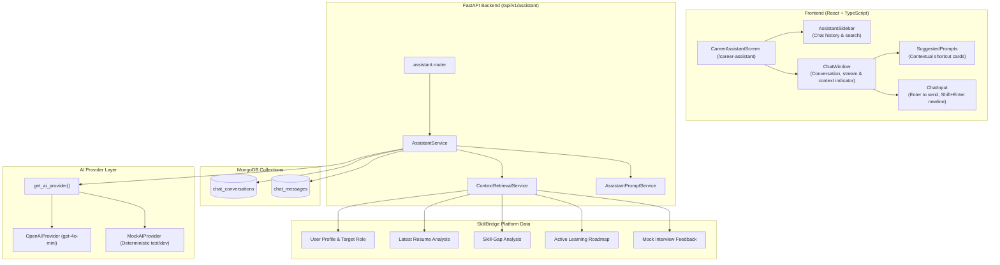

# SkillBridge AI — Day 13: AI Career Assistant (Personalized AI Chatbot)

## 1. Feature Overview

Day 13 introduces the **AI Career Assistant (Personalized AI Chatbot)** into SkillBridge AI. Rather than acting as a generic conversational chatbot, the Assistant serves as a grounded, context-aware technical career copilot. It dynamically pulls the authenticated candidate's active platform data—profile, resume analysis, skill-gap analysis, learning roadmap milestones, and mock interview feedback—to provide highly tailored advice, project recommendations, interview preparation strategies, and resume refinement suggestions.



---

## 2. Personalized Context Retrieval Engine

The [`ContextRetrievalService`](file:///Users/macos/Documents/Skillbridge/backend/app/services/assistant/context_retrieval_service.py) gathers structured, high-signal insights without exceeding token budgets or failing on missing modules:

1. **User Profile**: Retrieves user target role, seniority level, headline, and bio.
2. **Resume Analysis**: Extracts overall ATS readiness score, verified skills, identified strengths, and improvement suggestions from the latest completed resume analysis.
3. **Skill-Gap Analysis**: Retrieves role match percentage, categorized matched skills, partially matched skills with gap reasons, and prioritized missing competencies.
4. **Learning Roadmap**: Resolves current active roadmap title, completion percentage, in-progress milestones, and upcoming tasks.
5. **Mock Interview Feedback**: Extracts recent interview scores (overall score, strengths, and targeted improvement areas).

### Token-Optimized Prompt Injection:
Instead of dumping full JSON objects or raw PDF texts, the service builds a clean Markdown summary under 600 tokens:
```text
=== CANDIDATE CAREER CONTEXT ===
- Target Role: Senior Backend Engineer
- User Name: Alex Candidate

[Resume Analysis]
- Overall ATS Score: 82/100
- Verified Skills: Python, FastAPI, Docker, PostgreSQL
- Key Strengths: Strong API architecture background

[Skill-Gap Analysis]
- Role Match: 70%
- Matched Skills: Python, FastAPI, Docker
- Missing Skills to Target: Kubernetes (Imp: 5), Redis (Imp: 4)

[Learning Roadmap]
- Active Roadmap: Senior Backend Engineer Accelerated Preparation Curriculum (Progress: 25%)
- Current Milestone: Phase 1: Core Scalability Patterns (in_progress)

[Mock Interview Feedback]
- Most Recent Interview Score: 85/100
- Key Growth Areas: Articulating concurrency trade-offs and edge cases
================================
```

---

## 3. Database Architecture & Collections

Two dedicated collections in MongoDB persist conversation histories with strict user isolation:

### `chat_conversations`
| Field | Type | Description |
| :--- | :--- | :--- |
| `id` | `ObjectId (str)` | Unique conversation identifier |
| `user_id` | `ObjectId (str)` | Scoped owner ID |
| `title` | `str` | Title (auto-generated from first message or user-edited) |
| `status` | `str` | `active` or `archived` |
| `created_at` | `datetime` | Creation timestamp |
| `updated_at` | `datetime` | Metadata modification timestamp |
| `last_message_at` | `datetime` | Timestamp of most recent user or assistant message |

- **Indexes**: Compound index on `[("user_id", 1), ("last_message_at", -1)]`.

### `chat_messages`
| Field | Type | Description |
| :--- | :--- | :--- |
| `id` | `ObjectId (str)` | Unique message identifier |
| `conversation_id` | `ObjectId (str)` | Parent conversation reference |
| `user_id` | `ObjectId (str)` | Scoped owner ID |
| `role` | `str` | `user`, `assistant`, or `system` |
| `content` | `str` | Text content of the message |
| `message_type` | `str` | Message type (default: `text`) |
| `context_metadata` | `dict` | Context sources included, model version, tokens |
| `created_at` | `datetime` | Message delivery timestamp |

- **Indexes**: Compound index on `[("conversation_id", 1), ("created_at", 1)]` and `[("user_id", 1)]`.

---

## 4. AI Provider Extension & SSE Streaming

1. **`BaseAIProvider`** was extended with:
   - `generate_text(system_prompt, user_prompt, conversation_history, temperature) -> str`
   - `generate_stream(system_prompt, user_prompt, conversation_history, temperature) -> AsyncGenerator[str, None]`
2. **`OpenAIProvider`** implements SSE streaming against `POST /chat/completions` with `"stream": true`, yielding chunks in real time and releasing connection resources cleanly.
3. **`MockAIProvider`** provides rich, contextual responses across skills, roadmaps, interviews, resumes, and project queries for offline execution and automated test suites.
4. **Server-Sent Events Endpoint**:
   - `POST /api/v1/assistant/conversations/{id}/stream`
   - Emits events in standard SSE format:
     - `data: {"chunk": "..."}\n\n`
     - `data: {"done": true, "message_id": "..."}\n\n`
     - `data: [DONE]\n\n`
   - Persists the completed assistant response to `chat_messages` upon stream finalization.

---

## 5. REST API Contract

All endpoints are registered under `/api/v1/assistant` and require `Bearer <token>` authentication:

| Method | Endpoint | Description |
| :--- | :--- | :--- |
| `POST` | `/conversations` | Create a new career chat session |
| `GET` | `/conversations` | List user's conversations (supports `?search=` and pagination) |
| `GET` | `/conversations/{id}` | Get conversation metadata |
| `PATCH` | `/conversations/{id}` | Rename conversation title |
| `DELETE` | `/conversations/{id}` | Delete conversation and cascade delete all messages |
| `GET` | `/conversations/{id}/messages` | Get paginated message history (`?skip=&limit=`) |
| `POST` | `/conversations/{id}/messages` | Synchronous prompt execution & response generation |
| `POST` | `/conversations/{id}/stream` | Real-time SSE response streaming |
| `GET` | `/context-summary` | Summary of active candidate context sources |

---

## 6. Frontend Architecture & Features

The Career Assistant is accessible at route `/career-assistant` and integrated into the primary sidebar navigation:

1. **`AssistantSidebar`**:
   - Lists past conversations ordered by most recent activity.
   - Live title search filter.
   - Inline conversation renaming and deletion with confirmation.
   - "New Chat" primary action.
   - Responsive drawer for mobile and tablet screens.
2. **`ChatWindow`**:
   - Top banner with conversation title, mobile menu trigger, and `ContextIndicator`.
   - Scrollable messages stream with auto-scroll.
   - Renders `ChatMessageItem` with copy action, timestamp, and "Grounded in your data" provenance tags.
   - Displays `TypingIndicator` during model response generation.
   - Empty state renders `SuggestedPrompts` featuring 6 targeted prompt shortcuts.
3. **`ChatInput`**:
   - Auto-growing multiline textarea.
   - Supports `Enter` to submit, `Shift + Enter` for line breaks.
   - Stop streaming button during active SSE generation.

---

## 7. Verification & Test Coverage

### Backend Test Suite (`pytest`):
- **File:** [`backend/tests/test_assistant.py`](file:///Users/macos/Documents/Skillbridge/backend/tests/test_assistant.py)
  - `test_create_and_get_conversation`: Validates custom and default conversation titles.
  - `test_list_and_search_conversations`: Validates pagination and title search filtering.
  - `test_update_and_delete_conversation`: Tests renaming and cascade deletion.
  - `test_cross_user_isolation`: Confirms User B cannot view, modify, or message User A's conversations.
  - `test_send_message_and_auto_title`: Confirms automatic first-message title generation and history persistence.
  - `test_stream_message_sse`: Validates SSE chunk delivery and final message persistence.
  - `test_context_summary_graceful`: Confirms graceful handling when platform modules have no records.
- **Suite Result:** **99 passed** (all backend tests passing).

### Frontend Test Suite (`vitest`):
- **File:** [`frontend/src/features/assistant/__tests__/CareerAssistant.test.tsx`](file:///Users/macos/Documents/Skillbridge/frontend/src/features/assistant/__tests__/CareerAssistant.test.tsx)
  - Sidebar rendering with conversations and context summary badges.
  - Active conversation message rendering with grounding tags.
  - Empty conversation suggested prompt cards.
  - User message typing, submission, and streaming callback handling.
  - Suggested prompt card click-to-send action.
- **Suite Result:** **67 passed** across all 11 test suites.
- **Production Build:** `npm run build` succeeds with 0 TypeScript compilation errors.

