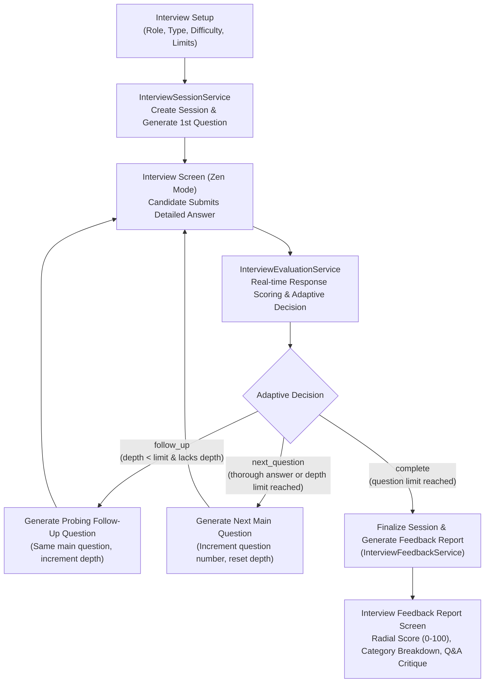

# SkillBridge AI — Day 11: AI Mock Interview System with Adaptive Follow-up Questions

## 1. Feature Overview

Day 11 introduces the **AI Mock Interview System with Adaptive Follow-up Questions** for SkillBridge AI. It provides candidates with realistic, dynamic, and distraction-free interview simulations tailored to target roles, interview types, and seniority levels.

Unlike static Q&A banks, SkillBridge AI evaluates candidate responses in real time. If an answer lacks depth or mentions complex architectures without addressing failure modes, the system dynamically probes the candidate with adaptive follow-up questions before advancing to the next main topic.

---

## 2. Adaptive Follow-up Engine & Decision Rules

The adaptive engine is governed by [`InterviewEvaluationService`](file:///Users/macos/Documents/Skillbridge/backend/app/services/interview/interview_evaluation_service.py) with strict rule-based guardrails surrounding AI completions:

### Decision Rules:
1. **Adaptive Follow-Up (`decision: "follow_up"`):**
   - Triggered when candidate response is vague, brief, or touches on critical concepts without practical depth, **and** `current_follow_up_depth < follow_up_limit_per_question` (default limit = 2).
   - Generates a targeted, conversational follow-up probing trade-offs, edge cases, or concurrency race conditions.
   - Preserves `question_number`, increments `follow_up_depth = follow_up_depth + 1`.
2. **Next Main Question (`decision: "next_question"`):**
   - Triggered when candidate answer is sufficiently thorough **or** when `current_follow_up_depth >= follow_up_limit_per_question`, provided `current_question_number < main_question_limit`.
   - Transitions to a distinct competency required for the target role.
   - Increments `question_number = question_number + 1`, resets `follow_up_depth = 0`.
3. **Session Completion (`decision: "complete"`):**
   - Triggered when the candidate completes the final main question (`current_question_number >= main_question_limit`).
   - Automatically marks session `status: "completed"`, records `completed_at`, and triggers `InterviewFeedbackService` to compile the evaluation report.

### Fallback Guarantee:
If the external AI provider is unreachable or times out, the service executes a deterministic rule-based evaluation based on candidate answer depth and keyword coverage, ensuring zero downtime or session hangs.

---

## 3. Database Schema Design (MongoDB)

All data is persisted in three collections designed on Day 2 in [`docs/database-design.md`](file:///Users/macos/Documents/Skillbridge/docs/database-design.md):

### 1. `interviews`
Tracks the session state, configuration, and progression pointers:
- `_id`: Unique ObjectId.
- `user_id`: Authenticated user ID (scoped ownership).
- `target_role_id` & `target_role_title`: Role benchmark reference.
- `interview_type`: `"technical"` | `"behavioral"` | `"hr"` | `"mixed"`.
- `difficulty`: `"beginner"` | `"intermediate"` | `"advanced"`.
- `status`: `"in_progress"` | `"completed"` | `"abandoned"`.
- `settings`: Object containing `main_question_limit` (e.g. 5), `follow_up_limit_per_question` (e.g. 2), `duration_minutes` (e.g. 30).
- `current_question_number`: 1-indexed counter of main questions.
- `current_follow_up_depth`: Depth counter for active question (0, 1, 2).
- `current_question_id`: Pointer to active question in `interview_messages`.
- `started_at`, `completed_at`, `created_at`, `updated_at`.

### 2. `interview_messages`
Stores the complete chronological conversation transcript:
- `_id`: Unique ObjectId.
- `interview_id`: Associated session ID.
- `user_id`: Scoped owner ID.
- `sequence`: 1-indexed sequence number (unique constraint with `interview_id`).
- `role`: `"assistant"` | `"user"`.
- `message_type`: `"question"` | `"answer"` | `"follow_up"`.
- `content`: Text of the question or candidate response.
- `parent_message_id`: ID of the message being responded to (enables duplicate prevention and tree linking).
- `question_number`: Main question index.
- `follow_up_depth`: Number of follow-ups into this main question.
- `evaluation`: Embedded object on user answers (`score`, `strengths`, `improvements`).

### 3. `interview_feedback`
Stores the post-interview evaluation report:
- `_id`: Unique ObjectId.
- `interview_id`: Unique index per interview.
- `user_id`: Scoped owner ID.
- `overall_score`: 0–100 weighted performance score.
- `category_scores`: List of category breakdowns (`Technical Knowledge`, `Problem Solving`, `Communication`, `Behavioral Competency`).
- `summary`: Executive evaluation summary.
- `strengths`: Concrete positive observations.
- `improvements`: Concrete growth opportunities.
- `recommended_practice`: Recommended practice topics and exercises.
- `answers_analysis`: Question-by-question breakdown with prompt, candidate answer, score, and critique.

---

## 4. REST API Endpoints

All endpoints are registered under `/api/v1/interviews` in [`backend/app/api/v1/endpoints/interviews.py`](file:///Users/macos/Documents/Skillbridge/backend/app/api/v1/endpoints/interviews.py):

| Method | Endpoint | Description | Status Code |
| :--- | :--- | :--- | :--- |
| `POST` | `/api/v1/interviews` | Create interview & generate opening question | `201 Created` |
| `GET` | `/api/v1/interviews` | List past and active sessions for user | `200 OK` |
| `GET` | `/api/v1/interviews/{id}` | Get session details and active question | `200 OK` |
| `GET` | `/api/v1/interviews/{id}/messages` | Get complete conversation transcript | `200 OK` |
| `POST` | `/api/v1/interviews/{id}/answers` | Submit answer & receive adaptive follow-up | `200 OK` |
| `POST` | `/api/v1/interviews/{id}/complete` | Finalize session & generate evaluation report | `200 OK` |
| `GET` | `/api/v1/interviews/{id}/feedback` | Retrieve completed evaluation report | `200 OK` |
| `PATCH` | `/api/v1/interviews/{id}/abandon` | Abandon in-progress interview session | `200 OK` |

### Security & Integrity Enforcement:
- **Strict User Scoping:** Every operation requires a valid JWT Bearer token and verifies `user_id == current_user.id`.
- **Idempotency & Duplicate Guards:** `POST /answers` checks if `parent_message_id == question_id` already exists. Duplicate submissions are rejected with `409 CONFLICT`.
- **Session Lifecycle Integrity:** Submitting answers to completed or abandoned interviews is rejected with `400 INTERVIEW_NOT_ACTIVE`.
- **Target Role Verification:** Validates `target_role_id` against seeded roles; raises `404 ROLE_NOT_FOUND` on invalid inputs.

---

## 5. Frontend Integration & Zen Mode

### 1. `InterviewSetupScreen.tsx`
- Fetches real job roles via `useJobRoles()`.
- Interactive category selection (Technical, Behavioral, Mixed).
- Seniority selector (Junior / Entry, Mid-Level, Senior / Staff).
- Session length configurator (3, 5, 8 questions).
- Displays active text practice mode and Phase 2 voice mode notice.

### 2. `InterviewScreen.tsx` (Zen Mode)
- Hosted outside the default sidebar layout on route `/interview/:interviewId`.
- Features [`ZenInterviewHeader`](file:///Users/macos/Documents/Skillbridge/frontend/src/components/layout/ZenInterviewHeader.tsx) with live pulse indicator, current question badge, follow-up depth tracker, elapsed timer, and exit button.
- Displays full conversation transcript history accordion so candidate can reference prior exchanges.
- Highlights active main question or adaptive follow-up probe.
- Answer drafting editor with real-time word counter and guidance hints.
- "Complete Session Early" action enabling on-demand report generation.

### 3. `InterviewFeedbackScreen.tsx`
- Displays overall benchmark score (0-100) inside an animated SVG radial gauge with candidate tier badges.
- Dimension progress bars for Technical Knowledge, Problem Solving, Communication, and Behavioral Competency.
- Executive AI evaluation summary.
- Key strengths observed and high-priority growth areas.
- Recommended practice topics.
- Interactive question-by-question accordion displaying prompt, candidate response, score, and AI critique.

### 4. `InterviewHistoryScreen.tsx`
- Paginated table/card view of all past sessions.
- Search by role title and filter by category.
- Displays date, duration, score badge, and quick actions ("View Report", "Resume", or "Retry").

---

## 6. Test Verification & Quality Assurance

### Backend Test Suite:
- **81 passed backend tests** in `pytest` with zero failures.
- Unit tests for `InterviewQuestionService`, `InterviewEvaluationService`, and `InterviewFeedbackService`.
- Full end-to-end flow test (`test_create_and_manage_interview_flow`): creates session, fetches messages, submits answer, verifies adaptive follow-up, tests duplicate rejection, completes session, verifies feedback report, lists past interviews.
- Cross-user isolation test (`test_cross_user_isolation`): verifies User B cannot view or answer User A's session.
- Abandonment test (`test_abandon_interview`).

### Frontend Test Suite:
- **51 passed vitest tests** across 9 test suites with zero failures.
- `InterviewScreens.test.tsx` covers `InterviewSetupScreen`, `InterviewScreen`, `InterviewFeedbackScreen`, and `InterviewHistoryScreen`.
- `npm run build` completed successfully with zero TypeScript compilation errors.

