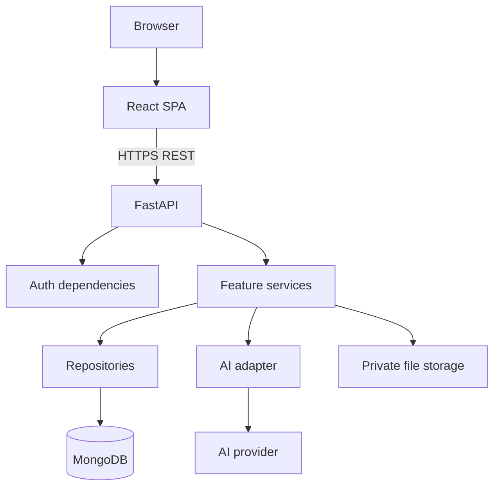

# SkillBridge AI — System Architecture

**Day 2 deliverable · MVP architecture**

## Architecture decisions
- Frontend: React + TypeScript + Vite, Tailwind CSS, shadcn/ui, React Router, React Hook Form + Zod, TanStack Query, Axios.
- Backend: FastAPI, Python, Pydantic, modular monolith.
- Database: MongoDB. Use a supported async PyMongo API (confirm compatibility/version during setup).
- AI: backend-only provider adapter/service abstraction.
- Files: private file/object storage; MongoDB stores metadata and storage keys.
- Auth: short-lived JWT access token and rotating refresh token in secure HttpOnly cookie.
- Testing: pytest for backend; choose frontend test stack during setup.

## High-level architecture



## Backend layers
- `api/`: HTTP routing, status codes, request/response mapping.
- `schemas/`: Pydantic request and response DTOs.
- `services/`: business workflows and ownership checks.
- `repositories/`: MongoDB queries and persistence.
- `models/`: persistence/document models.
- `core/`: configuration, security, errors, logging.
- `services/ai/`: provider abstraction, prompts, output validation.

Suggested backend structure:

```text
backend/app/
├── api/v1/endpoints/
├── core/
├── db/
├── dependencies/
├── models/
├── schemas/
├── repositories/
├── services/ai/prompts/
└── main.py
```

Route handlers should remain thin. Do not place database queries or AI orchestration directly in endpoint functions.

## Frontend structure

```text
frontend/src/
├── app/                 # providers, router, layouts
├── components/ui/        # reusable UI primitives
├── components/common/
├── features/
│   ├── auth/
│   ├── dashboard/
│   ├── resume/
│   ├── skill-gap/
│   ├── roadmap/
│   └── interview/
├── hooks/
├── lib/                 # Axios client and utilities
├── services/             # API functions
└── types/
```

Keep API calls in service modules, server state in TanStack Query, and UI-only state in React state. Include loading, error, empty, and success states.

## AI provider abstraction
Feature services call an internal AI interface rather than a vendor SDK directly. Validate structured AI output with Pydantic; use timeouts, rate-limit handling, and bounded prompt context. Keep API keys on the backend. Avoid logging full resumes, interview answers, or secrets. AI scores are estimates—not hiring probabilities.

## Resume processing flow
1. Authenticated upload.
2. Validate size, extension, MIME and file signature where possible.
3. Store file privately; save metadata in MongoDB.
4. Extract PDF/DOCX text in a service.
5. Run AI analysis with input-size limits.
6. Validate output and save analysis.
7. Return status/result.

Statuses: `uploaded`, `processing`, `completed`, `failed`. Never store raw file bytes in MongoDB or trust filename/MIME alone.

## Adaptive interview flow
1. Create interview and settings.
2. Generate first question.
3. Save user answer.
4. Evaluate answer and generate a follow-up or next question.
5. Enforce configured question/follow-up limits.
6. Complete interview and generate feedback.
Use bounded conversation context; summarize older context if needed.

## Security and deployment
- HTTPS, CORS allowlist, password hashing (Argon2id), access-token expiry, refresh rotation.
- Enforce resource ownership on every user-owned record.
- Rate-limit login, upload, and AI-heavy endpoints.
- Keep secrets in environment variables/secret manager.
- Never execute arbitrary code in the FastAPI process.
- Deployment: frontend hosting/CDN → FastAPI → managed MongoDB, private storage, external AI provider.
- Use separate development/staging/production configuration.

## MVP vs later
MVP: auth/profile, resume analysis, role selection, skill-gap, roadmap, text interview with adaptive follow-ups, feedback/history, dashboard.
Later: voice interview, coding sandbox, career assistant, notifications, advanced analytics.
