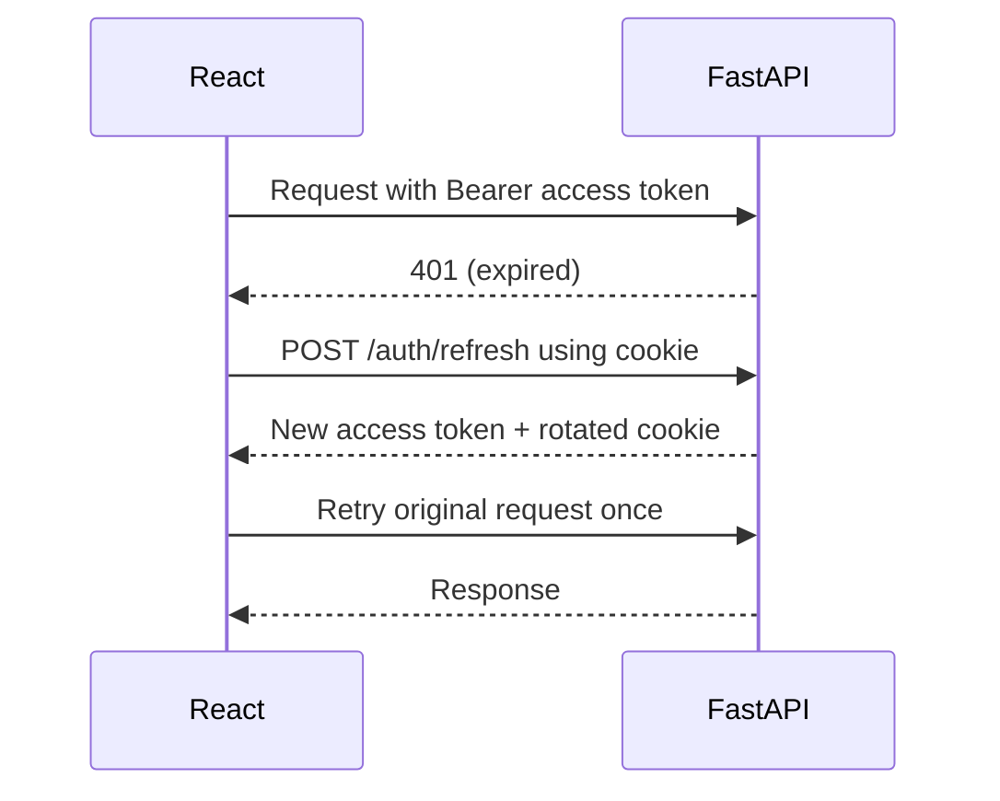

# SkillBridge AI — Authentication & Authorization Design

**Day 2 deliverable · Initial implementation design**

## Goals
- Secure registration/login.
- Short-lived access JWTs.
- Refresh and logout with revocation.
- Enforce ownership of all private user data.
- Avoid exposing refresh tokens to JavaScript.

## Token approach
| Token | Use | Handling |
|---|---|---|
| Access JWT | API authorization | Short-lived; keep in memory where practical |
| Refresh token | Renew access token | Secure HttpOnly cookie, rotated on refresh |

Suggested configurable defaults: access token 10–15 minutes; refresh session 7–30 days. These are design defaults, not fixed requirements.

Cookie flags:
- `HttpOnly`
- `Secure` in production
- `SameSite=Lax` or stricter if compatible
- narrow auth path and suitable expiration

Cookie refresh needs CSRF consideration. Use SameSite protections and origin/CSRF checks where required, particularly if cross-site cookies (`SameSite=None`) are used.

## Registration
1. Validate request.
2. Normalize email to lowercase.
3. Check unique email index.
4. Hash password with Argon2id using a maintained library.
5. Create user.
6. Return safe user DTO, never password hash.
7. Decide whether registration auto-logs in or requires login/email verification.

## Login
1. Submit credentials over HTTPS.
2. Find user by normalized email.
3. Verify password hash and active status.
4. Create server-side refresh session (recommended).
5. Issue access token.
6. Set refresh cookie.
7. Return access token and safe user profile.

Minimal access JWT claims:

```json
{
  "sub": "user_id",
  "type": "access",
  "iat": 1730000000,
  "exp": 1730000900,
  "jti": "opaque-token-id"
}
```

Do not put resume/profile data or other sensitive details in JWT claims.

## Refresh and rotation
1. Browser sends refresh cookie to `/auth/refresh`.
2. Backend validates signature, expiry, token type and session.
3. Revoke/rotate the old refresh token.
4. Issue a new access token and refresh cookie.
5. Detect refresh-token replay; revoke associated session/token family and require login.

Store a hash or opaque session identifier for refresh-token tracking, not raw tokens.

## Logout
1. Call `/auth/logout`.
2. Revoke refresh session.
3. Clear cookie using matching attributes.
4. Clear frontend auth state and private query cache.
5. Redirect to login.

Access JWTs may remain valid until expiry unless a denylist is used; short expiry limits the exposure.

## Frontend request flow


Axios interceptors:
- Attach access token.
- Handle eligible 401 responses.
- Use one shared refresh promise for concurrent requests.
- Never retry refresh itself.
- Retry original request at most once.
- On refresh failure, clear auth state and redirect.
- Prevent infinite refresh loops.

## Authorization
- FastAPI dependency resolves authenticated user.
- Pass user identity to services.
- Scope DB reads/writes by resource ID and authenticated `user_id`.
- Never trust owner IDs from client.
- Check admin role explicitly for admin-only actions.
- Return 404 for inaccessible resources when appropriate to prevent enumeration.

## Security controls
- Argon2id password hashing.
- Rate-limit login/register/refresh/upload/AI endpoints.
- Generic login failure messages.
- HTTPS in production.
- CORS allowlist; configure credentials intentionally.
- Keep signing keys and AI credentials in secrets/environment.
- Never log passwords, cookies, tokens, resume text, or interview answers.
- Email verification and password reset should be added before public production launch.

## Environment variables (names/placeholders only)
```env
JWT_SECRET_KEY=replace_with_secure_random_secret
JWT_ALGORITHM=HS256
ACCESS_TOKEN_EXPIRE_MINUTES=15
REFRESH_TOKEN_EXPIRE_DAYS=14
AUTH_COOKIE_NAME=skillbridge_refresh
AUTH_COOKIE_SECURE=true
AUTH_COOKIE_SAMESITE=lax
FRONTEND_ORIGIN=http://localhost:5173
```
Never commit real secrets. `.env.example` should contain placeholders only.

## MVP decision
Implement email/password, access JWT, refresh cookie with rotation/session tracking, current-user endpoint, and user/admin roles. Defer verification/reset only for local development; add before public production release.
