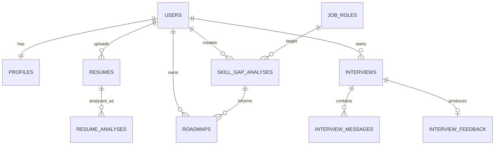

# SkillBridge AI — MongoDB Database Design

**Day 2 deliverable · Initial MVP schema**

## Conventions
- MongoDB `ObjectId` for internal IDs; serialize as strings in API responses.
- UTC timestamps.
- Every user-owned record contains `user_id`.
- Shared catalog records (roles/skills) are not user-owned.
- Store uploaded files in private storage; MongoDB stores metadata/storage key.
- Use Pydantic DTOs for API contracts; do not return raw MongoDB documents.

## Collections
| Collection | Purpose |
|---|---|
| `users` | Authentication identity |
| `profiles` | Career profile |
| `resumes` | Upload metadata |
| `resume_analyses` | AI analysis history |
| `job_roles` | Shared role catalog |
| `skills` | Shared skill catalog |
| `skill_gap_analyses` | Resume/role skill comparison |
| `roadmaps` | Personalized plan |
| `interviews` | Session metadata |
| `interview_messages` | Questions and answers |
| `interview_feedback` | Final report |

`conversations` and `messages` can be added later if the career assistant enters scope.

## Document examples

### users
```json
{
  "_id": "ObjectId",
  "email": "user@example.com",
  "password_hash": "hashed-password",
  "display_name": "Example User",
  "role": "user",
  "is_active": true,
  "email_verified": false,
  "created_at": "UTC datetime",
  "updated_at": "UTC datetime",
  "last_login_at": null
}
```
Normalize email to lowercase. Never return `password_hash`.

### profiles
```json
{
  "_id": "ObjectId",
  "user_id": "ObjectId",
  "headline": "Backend Developer",
  "years_of_experience": 5,
  "current_role": "Software Developer",
  "target_role_id": "ObjectId or null",
  "target_role_title": "Backend Engineer",
  "skills": ["Python", "FastAPI", "React"],
  "career_goal": "Prepare for backend interviews",
  "created_at": "UTC datetime",
  "updated_at": "UTC datetime"
}
```

### resumes
```json
{
  "_id": "ObjectId",
  "user_id": "ObjectId",
  "original_filename": "resume.pdf",
  "storage_key": "private/resumes/opaque-id",
  "file_type": "pdf",
  "file_size_bytes": 123456,
  "content_hash": "optional SHA-256",
  "status": "uploaded",
  "created_at": "UTC datetime",
  "updated_at": "UTC datetime"
}
```
Statuses: `uploaded`, `processing`, `completed`, `failed`.

### resume_analyses
```json
{
  "_id": "ObjectId",
  "user_id": "ObjectId",
  "resume_id": "ObjectId",
  "analysis_version": 1,
  "status": "completed",
  "overall_score": 78,
  "summary": "Concise summary",
  "strengths": ["Strong API experience"],
  "improvements": ["Add measurable outcomes"],
  "skills_detected": ["Python", "FastAPI"],
  "recommended_roles": [{"role_id": "ObjectId", "title": "Backend Engineer", "match_score": 0.82}],
  "ai_metadata": {"provider": "provider", "model": "model", "prompt_version": "resume-v1"},
  "created_at": "UTC datetime"
}
```
Scores are advisory estimates, not hiring predictions.

### job_roles
```json
{
  "_id": "ObjectId",
  "slug": "backend-engineer",
  "title": "Backend Engineer",
  "category": "Engineering",
  "required_skills": [{"skill_id": "ObjectId", "name": "Python", "importance": 5}],
  "optional_skills": [{"skill_id": "ObjectId", "name": "Docker"}],
  "is_active": true
}
```

### skills
```json
{
  "_id": "ObjectId",
  "slug": "fastapi",
  "name": "FastAPI",
  "category": "Backend",
  "aliases": ["Fast API"],
  "is_active": true
}
```

### skill_gap_analyses
```json
{
  "_id": "ObjectId",
  "user_id": "ObjectId",
  "resume_id": "ObjectId or null",
  "target_role_id": "ObjectId",
  "target_role_title": "Backend Engineer",
  "skills": [{
    "skill_name": "Docker",
    "required_level": 4,
    "current_level": 2,
    "gap": 2,
    "priority": "high",
    "evidence": "Limited resume evidence"
  }],
  "created_at": "UTC datetime"
}
```
Define a consistent proficiency scale (e.g. 1–5) and explain it in UI.

### roadmaps
```json
{
  "_id": "ObjectId",
  "user_id": "ObjectId",
  "skill_gap_analysis_id": "ObjectId",
  "target_role_id": "ObjectId",
  "title": "Backend Engineer Preparation Plan",
  "status": "active",
  "duration_weeks": 8,
  "weeks": [{
    "week_number": 1,
    "goal": "Build Python fundamentals",
    "tasks": [{
      "task_id": "stable string ID",
      "title": "Review Python collections",
      "estimated_minutes": 60,
      "status": "pending"
    }]
  }],
  "created_at": "UTC datetime",
  "updated_at": "UTC datetime"
}
```
Embed bounded roadmap weeks/tasks; use stable task IDs for updates.

### interviews
```json
{
  "_id": "ObjectId",
  "user_id": "ObjectId",
  "target_role_id": "ObjectId or null",
  "target_role_title": "Backend Engineer",
  "interview_type": "technical",
  "difficulty": "medium",
  "mode": "text",
  "status": "in_progress",
  "settings": {"main_question_limit": 8, "follow_up_limit_per_question": 2},
  "started_at": "UTC datetime",
  "completed_at": null,
  "created_at": "UTC datetime",
  "updated_at": "UTC datetime"
}
```
Types: `technical`, `behavioral`, `mixed`; modes initially `text`; statuses `created`, `in_progress`, `completed`, `cancelled`.

### interview_messages
```json
{
  "_id": "ObjectId",
  "user_id": "ObjectId",
  "interview_id": "ObjectId",
  "sequence": 1,
  "role": "assistant",
  "message_type": "question",
  "content": "Explain dependency injection in FastAPI.",
  "parent_message_id": null,
  "question_number": 1,
  "follow_up_depth": 0,
  "created_at": "UTC datetime"
}
```
Use roles `assistant`/`user`; message types such as `question`, `answer`, `follow_up`. Keep growing transcripts in this collection, not embedded in the interview document.

### interview_feedback
```json
{
  "_id": "ObjectId",
  "user_id": "ObjectId",
  "interview_id": "ObjectId",
  "overall_score": 72,
  "summary": "Performance summary",
  "strengths": ["Structured responses"],
  "improvements": ["Add concrete examples"],
  "category_scores": [{"category": "communication", "score": 3, "max_score": 5}],
  "recommended_practice": ["Review REST API design"],
  "created_at": "UTC datetime"
}
```
MVP: one feedback record per completed interview.

## Relationships


## Indexes
| Collection | Index |
|---|---|
| `users` | `{ email: 1 }` unique |
| `profiles` | `{ user_id: 1 }` unique |
| `resumes` | `{ user_id: 1, created_at: -1 }` |
| `resume_analyses` | `{ user_id: 1, resume_id: 1, created_at: -1 }` |
| `job_roles` | `{ slug: 1 }` unique |
| `skills` | `{ slug: 1 }` unique |
| `skill_gap_analyses` | `{ user_id: 1, created_at: -1 }` |
| `roadmaps` | `{ user_id: 1, status: 1, updated_at: -1 }` |
| `interviews` | `{ user_id: 1, created_at: -1 }` |
| `interview_messages` | `{ interview_id: 1, sequence: 1 }` unique |
| `interview_feedback` | `{ interview_id: 1 }` unique |

## Ownership rule
Always scope resource queries by resource ID and authenticated user ID, e.g.:

```python
await collection.find_one({"_id": resource_id, "user_id": current_user.id})
```

Never trust `user_id` from client input. MongoDB does not enforce foreign keys; validate references in services.

## Embedding/reference rules
- Embed small bounded data (roadmap weeks/tasks, role requirements).
- Reference independently paginated or growing data (interview messages, analyses).
- Keep role/skill catalogs shared and separate.

## Lifecycle/privacy
Deleting a resume should delete its private storage object and define what happens to analyses/roadmaps. Implement account deletion across user-owned collections. Avoid logging resume content, answers, tokens, or credentials. Apply deliberate retention policies; do not add TTL indexes without a clear requirement.
