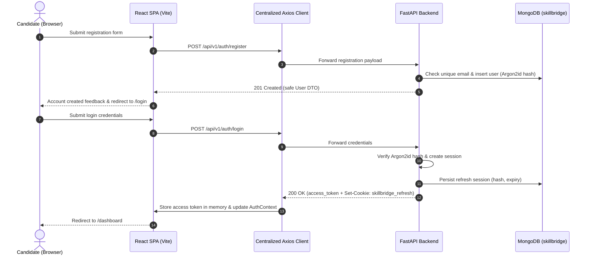

# SkillBridge AI — Frontend-Backend Integration & Authentication (Day 6)

**Phase 1 · Week 1 · Day 6 Deliverable**  
**Role:** Senior Full-Stack Engineer  
**Status:** Completed and Verified End-to-End  

---

## 1. Overview & Architecture

Day 6 establishes secure, production-grade communication between the React 19 / Vite frontend and the FastAPI backend, implementing real authentication backed by MongoDB.



---

## 2. API Client Configuration (`frontend/src/lib/axios.ts`)

The centralized Axios client provides:
1. **Base URL Configuration**: Read dynamically from `import.meta.env.VITE_API_BASE_URL` (defaults to `http://localhost:8000/api/v1`).
2. **Credential Inclusion**: `withCredentials: true` ensures that HttpOnly session cookies are transmitted for cross-origin local and production requests.
3. **Request Timeout**: Configured to 15 seconds to gracefully handle slow network conditions.
4. **In-Memory Token Attachment**: Attaches `Authorization: Bearer <token>` dynamically from memory rather than exposing tokens in insecure local storage.
5. **Concurrency-Safe 401 Refresh Queue**:
   - If an API request receives a `401 Unauthorized` and is not already retrying, the client initiates `POST /auth/refresh`.
   - Concurrent outgoing requests are paused and queued using a callback subscriber.
   - When the token refresh completes, queued requests are automatically dispatched with the new access token.
   - If refresh fails, tokens and user state are purged, and the user is redirected to `/login`.
   - The refresh request itself is never retried, preventing infinite refresh loops.

---

## 3. Authentication & Token Strategy

| Token | Type | Expiry | Storage Location | Transmission |
|---|---|---|---|---|
| **Access Token** | JWT (HS256) | 15 Minutes | In-Memory (Closure state in `axios.ts`) | `Authorization: Bearer <token>` header |
| **Refresh Token** | JWT (HS256) | 14 Days | HttpOnly, SameSite=Lax Cookie (`skillbridge_refresh`) | Automatic browser cookie transmission |

### Refresh Token Security & Rotation
1. **Token Hashing in DB**: The backend stores only the SHA-256 hash of the refresh token in the `refresh_sessions` collection.
2. **Single-Use Rotation**: Every successful refresh call invalidates the prior refresh token, persists a new token hash, and issues a fresh HttpOnly cookie.
3. **Replay Detection**: If a previously used refresh token is presented, the system detects session tampering, revokes all sessions for that user, and requires re-authentication.

---

## 4. Protected Routes & Navigation Flow

Route protection is managed by React Router v7 and centralized in `frontend/src/routes/index.tsx`:

### Protected Routes (`<ProtectedRoute />`)
All core platform routes require active candidate authentication:
- `/dashboard`
- `/resume`
- `/skill-gap`
- `/roadmap`
- `/interview/setup`
- `/interview/:interviewId` (Zen Mode)
- `/interview/:interviewId/feedback`
- `/interview-history`
- `/profile`
- `/settings`

**Behavior**:
- While initial session recovery is executing, a branded loading screen (`Verifying secure session...`) is displayed.
- Unauthenticated access redirects immediately to `/login`, preserving the intended destination in `location.state.from`.
- Authenticated candidates proceed directly to the requested screen.

### Public-Only Routes (`<PublicOnlyRoute />`)
- `/login`
- `/register`

**Behavior**:
- Authenticated candidates attempting to access `/login` or `/register` are automatically redirected to `/dashboard` (or their intended destination).

---

## 5. Logout Flow

1. Candidate clicks the **Sign Out** button in either the top utility bar (`AppHeader`) or sidebar profile footer (`AppSidebar`).
2. Frontend calls `POST /api/v1/auth/logout`.
3. Backend marks the refresh session as `is_revoked: true` in MongoDB and clears the `skillbridge_refresh` cookie (`Max-Age=0`).
4. Frontend clears the in-memory access token and sets `user: null` in `AuthContext`.
5. Candidate is redirected to `/login`.

---

## 6. Backend API Contracts Implemented

### 1. Registration: `POST /api/v1/auth/register`
- **Request Body**:
  ```json
  {
    "name": "Alex Vance",
    "email": "alex.vance@example.com",
    "password": "Password123!"
  }
  ```
- **Response (201 Created)**:
  ```json
  {
    "id": "6724a1b89ef94d688cf98a12",
    "name": "Alex Vance",
    "email": "alex.vance@example.com",
    "role": "user",
    "is_active": true,
    "created_at": "2026-11-13T10:30:00Z"
  }
  ```
- **Error (409 Conflict)**: Email already registered.
- **Error (422 Unprocessable)**: Validation error (e.g., short password, invalid email).

### 2. Login: `POST /api/v1/auth/login`
- **Request Body**:
  ```json
  {
    "email": "alex.vance@example.com",
    "password": "Password123!"
  }
  ```
- **Response (200 OK)**:
  ```json
  {
    "access_token": "eyJhbGciOiJIUzI1Ni...",
    "token_type": "bearer",
    "expires_in": 900,
    "user": {
      "id": "6724a1b89ef94d688cf98a12",
      "name": "Alex Vance",
      "email": "alex.vance@example.com",
      "role": "user",
      "is_active": true,
      "created_at": "2026-11-13T10:30:00Z"
    }
  }
  ```
- **Header**: `Set-Cookie: skillbridge_refresh=...; HttpOnly; Path=/api/v1/auth; SameSite=lax`
- **Error (401 Unauthorized)**: Generic message "Invalid email or password".

### 3. Token Refresh: `POST /api/v1/auth/refresh`
- **Request**: Cookie `skillbridge_refresh`
- **Response (200 OK)**: Rotated access token and safe user profile.
- **Header**: Rotated `Set-Cookie: skillbridge_refresh=...`

### 4. Logout: `POST /api/v1/auth/logout`
- **Request**: Cookie `skillbridge_refresh`
- **Response (200 OK)**: `{"message": "Successfully logged out"}`
- **Header**: `Set-Cookie: skillbridge_refresh=; Max-Age=0; Path=/api/v1/auth`

### 5. Current User: `GET /api/v1/auth/me`
- **Request**: `Authorization: Bearer <access_token>`
- **Response (200 OK)**: Authenticated `UserRead` DTO.

---

## 7. Centralized Error Handling

All backend errors follow the standardized error schema documented in `docs/api-design.md`:

```json
{
  "error": {
    "code": "STRING_ERROR_CODE",
    "message": "Human-readable explanation.",
    "details": [],
    "request_id": "opaque-uuid"
  }
}
```

The frontend client intercepts errors and presents friendly alerts:
- **400 / 422**: Formats field validation errors concisely.
- **401**: Prompts candidate with session expiration or credential invalidity.
- **409**: Highlights duplicate email registration conflicts.
- **500**: Generic "A server error occurred. Please try again later." without leaking backend stack traces.
- **Network / Timeout**: "Network error: Unable to connect to SkillBridge server. Please ensure the backend is running."

---

## 8. CORS & Cookie Configuration

- **Frontend Origin**: `http://localhost:5173`
- **Backend Origin**: `http://localhost:8000`
- **CORS Allowed Origins**: `["http://localhost:5173", "http://127.0.0.1:5173"]`
- **Credentials Allowed**: `true` (Wildcard `*` is explicitly disabled to comply with browser CORS specifications when credentials are used).
- **Cookie Security**:
  - `HttpOnly`: Enforced on all refresh cookies (inaccessible to JS).
  - `SameSite`: `lax` (prevents CSRF while allowing standard top-level cross-site navigations).
  - `Secure`: Set to `false` in local development; automatically toggled to `true` when `AUTH_COOKIE_SECURE=true` in production HTTPS environments.

---

## 9. Local Setup Instructions

### 1. Start MongoDB
Ensure MongoDB is running locally on port 27017:
```bash
mongod --dbpath .mongo_data --port 27017
```

### 2. Start the Backend
```bash
cd backend
source .venv/bin/activate
uvicorn app.main:app --reload --port 8000
```
Backend will be available at `http://localhost:8000/api/v1`. Swagger documentation is at `http://localhost:8000/api/v1/docs`.

### 3. Start the Frontend
```bash
cd frontend
npm run dev
```
Frontend will be available at `http://localhost:5173/`.

---

## 10. Automated Tests & Verification Results

### Backend Test Suite (`pytest`)
- Total tests executed: **16**
- Passing: **16 / 16 (100%)**
- Test Coverage:
  - `test_register_success`
  - `test_register_duplicate_email`
  - `test_register_validation_error`
  - `test_login_success_and_cookie`
  - `test_login_invalid_password`
  - `test_login_nonexistent_user`
  - `test_me_endpoint_authenticated`
  - `test_me_endpoint_unauthenticated`
  - `test_me_endpoint_expired_token`
  - `test_token_refresh_and_rotation`
  - `test_logout_revokes_session`
  - `test_argon2_password_hashing`
  - `test_access_token_generation_and_decoding`
  - `test_refresh_token_generation_and_decoding`
  - `test_expired_token_handling`
  - `test_token_hash_deterministic`

### Frontend Test Suite (`vitest`)
- Total tests executed: **15**
- Passing: **15 / 15 (100%)**
- Test Coverage:
  - `RegisterScreen.test.tsx`: Empty validation, password mismatch, successful registration, duplicate email API conflict handling.
  - `LoginScreen.test.tsx`: Empty field validation, successful login & dashboard navigation, invalid credentials alert, network failure feedback.
  - `AuthContext.test.tsx`: Silent session recovery via cookie, login state update, logout state purge.
  - `ProtectedRoute.test.tsx`: Loading state verification, unauthenticated redirect to `/login`, authenticated pass-through.

### End-to-End Integration Verification (`scratch/verify_e2e_scenarios.py`)
All 7 required manual integration scenarios were verified against the live MongoDB, FastAPI, and Vite services:
- **Scenario 1**: Registration and Argon2id hash verified in MongoDB. Duplicate email rejected (409).
- **Scenario 2**: Valid login verified; access token and HttpOnly cookie verified.
- **Scenario 3**: Invalid password rejected with 401 and generic message.
- **Scenario 4**: Browser persistence via cookie refresh and `/auth/me` verification confirmed.
- **Scenario 5**: Direct access to protected endpoints blocked without credentials (401).
- **Scenario 6**: Logout revoked session in MongoDB and blocked subsequent refresh calls.
- **Scenario 7**: Dev server accessibility and CORS headers verified.

---

## 11. Known Limitations & Deferred Features

1. **Email Verification & Password Reset**: Placeholder recovery notification implemented for development; email delivery (SMTP/SES) deferred to production hardening.
2. **Feature APIs**: Resume parsing, skill gap calculations, and AI interviews remain in mock mode in accordance with Day 6 scope boundaries.

