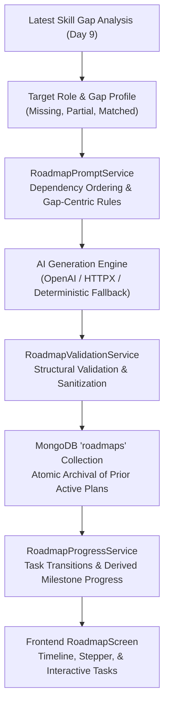

# SkillBridge AI — Day 10: Personalized Learning Roadmap Generation and Progress Tracking

## 1. Feature Overview

Day 10 introduces the **Personalized Learning Roadmap Engine** for SkillBridge AI. It synthesizes a structured, milestone-driven preparation curriculum directly from the candidate's verified skill-gap assessment (Day 9) and target job role benchmarks.

The roadmap bridges the candidate's specific missing competencies and partially matched skills through sequential, dependency-aware learning milestones and actionable tasks, tracking progress in real time with automated milestone updates and completion percentages.



---

## 2. Roadmap Generation Workflow

1. **Authentication & Input Resolution:** Authenticated user triggers roadmap generation (`POST /api/v1/roadmaps/generate`).
2. **Skill-Gap Evaluation:** Resolves the candidate's latest valid skill-gap analysis (`skill_gap_analyses` collection). Rejects with `400 NO_SKILL_GAP_ANALYSIS` if no analysis exists.
3. **Role Context:** Retrieves job role title and description from `job_roles`.
4. **AI Curriculum Synthesis:**
   - Evaluates matched skills as established candidate strengths (not re-taught from scratch).
   - Identifies missing skills as high-priority foundational modules.
   - Identifies partially matched skills for intermediate deepening and optimization.
   - Enforces dependency sequence (e.g., JavaScript/TypeScript before React, Core Python/SQL before asynchronous FastAPI, Docker basics before CI/CD).
5. **AI Validation & Sanitization:** Output is verified by `RoadmapValidationService` ensuring non-empty milestones, sequential unique ordering ($1, 2, 3\dots$), allowed task types, positive durations, and unique task identifiers.
6. **Prior Plan Archival:** Automatically marks previous active roadmaps for the user as `archived`.
7. **Persistence:** Saves the new active roadmap in the `roadmaps` collection with `status: "active"` and `completion_percentage: 0`.

---

## 3. AI Prompt & Curriculum Design

### System Prompt
Configured in [`roadmap_prompt_service.py`](file:///Users/macos/Documents/Skillbridge/backend/app/services/roadmap/roadmap_prompt_service.py):
- Acts as a senior tech curriculum architect and career preparation mentor.
- Enforces strict JSON output adhering to milestone and task schemas.
- Prohibits hallucinating external course URLs; provides authoritative documentation titles or search phrases instead.

### User Prompt Input
- Target job role title and description.
- Candidate weekly study commitment (hours/week, if provided).
- List of already verified competencies (candidate strengths).
- Partially matched competencies with specific gap reasons.
- Missing required competencies with priority weights ($1-5$).

---

## 4. Milestone & Task Structure

### Roadmap
- `id`: Unique string ID (converted from MongoDB `ObjectId`).
- `user_id`: Scoped owner ID.
- `target_role_id` & `target_role_title`: Role benchmark reference.
- `source_skill_gap_analysis_id`: Provenance linking to Day 9 analysis.
- `title` & `description`: Comprehensive curriculum objective.
- `estimated_duration_days`: Overall duration estimate (e.g. 30–60 days).
- `milestones`: Array of sequential `Milestone` objects.
- `status`: `"active"` | `"completed"` | `"archived"`.
- `completion_percentage`: Integer ($0-100$).
- `is_stale`: Dynamically evaluated boolean.

### Milestones
- `id`: Stable identifier (e.g. `m_1_abc123`).
- `title`: Milestone objective (e.g. *"Phase 1: Core Systems & High-Impact Gaps"*).
- `description`: Educational goals for this phase.
- `order`: Sequential integer ($1, 2, 3\dots$).
- `estimated_duration_days`: Estimated duration in days.
- `priority`: `"high"` | `"medium"` | `"low"`.
- `status`: Derived status (`"not_started"`, `"in_progress"`, `"completed"`).
- `related_skills`: Skills exercised in this phase.
- `tasks`: 2 to 4 actionable `Task` objects.

### Tasks
- `id`: Stable identifier (e.g. `m_1_t_1_def456`).
- `title`: Actionable task name.
- `description`: Instructions and learning outcomes.
- `task_type`: `"learn"` | `"practice"` | `"project"` | `"assessment"` | `"revise"`.
- `related_skill`: Targeted competency.
- `estimated_duration_hours`: Estimated time in hours ($1-100$).
- `priority`: `"high"` | `"medium"` | `"low"`.
- `status`: `"not_started"` | `"in_progress"` | `"completed"`.
- `completed_at`: UTC timestamp set upon completion, cleared upon reopening.
- `resources`: Curated authoritative documentation topics or search keywords.

---

## 5. Progress Tracking & State Transitions

### Task Status Transitions
Users interactively update task status via `PATCH /api/v1/roadmaps/{roadmap_id}/tasks/{task_id}`:
```
not_started  ──(Start Task)──>  in_progress  ──(Mark Completed)──>  completed
     ▲                                ▲                                 │
     │                                └─────────(Reopen Task)───────────┘
```

### Derived Milestone Progress
Milestone statuses are computed from task states:
- **Completed:** All tasks in the milestone have `status: "completed"`.
- **In Progress:** At least one task has `status: "in_progress"` or `"completed"`, but not all tasks are finished.
- **Not Started:** All tasks have `status: "not_started"`.

### Roadmap Completion Percentage
$$\text{Completion Percentage} = \min\left(100, \max\left(0, \operatorname{round}\left( \frac{\text{Completed Tasks}}{\text{Total Tasks}} \times 100 \right)\right)\right)$$

- When $\text{Completed Tasks} = \text{Total Tasks}$ and $\text{Total Tasks} > 0$, roadmap status transitions to `"completed"`.
- If a task is reopened, roadmap status automatically returns to `"active"`.

---

## 6. Stale Roadmap Handling

A roadmap is derived from a specific skill-gap analysis. The system detects when an active roadmap has become outdated:
1. If the user generates a newer skill-gap analysis (e.g., uploaded a new resume or changed target roles).
2. If the source skill-gap analysis itself was marked `is_stale: true`.

When detected:
- The backend dynamically sets `is_stale: true` in `GET /api/v1/roadmaps/current`.
- The frontend displays an alert banner: *"Curriculum Calibrated to Previous Version"* with a one-click *"Regenerate Roadmap"* action button.

---

## 7. REST API Specification

| Method | Endpoint | Description | Auth Required |
|---|---|---|---|
| `POST` | `/api/v1/roadmaps/generate` | Generate a personalized learning roadmap from latest skill gap | Yes (JWT) |
| `POST` | `/api/v1/roadmaps` | Alias route matching Day 2 specification | Yes (JWT) |
| `GET` | `/api/v1/roadmaps/current` | Get user's active roadmap with dynamic stale evaluation | Yes (JWT) |
| `GET` | `/api/v1/roadmaps/{roadmap_id}` | Get specific roadmap (scoped to authenticated user) | Yes (JWT) |
| `PATCH` | `/api/v1/roadmaps/{roadmap_id}/tasks/{task_id}` | Update task status (`not_started`, `in_progress`, `completed`) | Yes (JWT) |
| `GET` | `/api/v1/roadmaps/{roadmap_id}/progress` | Get detailed milestone & task completion metrics | Yes (JWT) |
| `PATCH` | `/api/v1/roadmaps/{roadmap_id}/archive` | Archive an active roadmap | Yes (JWT) |
| `GET` | `/api/v1/roadmaps` | List user's roadmaps with optional status filter | Yes (JWT) |

---

## 8. Frontend Integration (`RoadmapScreen.tsx`)

- **Overall Progress Banner:** Displays target job role, total task count, overall completion percentage progress bar, and estimated remaining hours.
- **Metrics Dashboard:** 4 summary cards for Milestones, Completed Tasks, In-Progress Tasks, and Remaining Hours.
- **Interactive Milestone Stepper:** Multi-phase cards with status badges (`Completed`, `In Progress`, `Not Started`) and estimated durations.
- **Task Action Controls:** One-click transitions to start tasks, mark tasks completed, or reopen completed tasks.
- **Authoritative Resource Badges:** Authoritative documentation and book topics suggested for each task.
- **Edge States:** Gracefully handles missing resume, unanalyzed resume, missing skill gap, stale roadmap warnings, and completed celebrations.

---

## 9. Automated Testing & Verification

### Backend Tests (`backend/tests/test_roadmap.py`)
- `test_roadmap_validation_success`: Verifies schema normalization, task typing, and ordering.
- `test_roadmap_validation_rejects_empty`: Verifies rejection of empty milestones or tasks.
- `test_roadmap_progress_calculation`: Validates task status transitions, derived milestone status, and 100% completion trigger.
- `test_roadmap_generate_no_skill_gap`: Verifies 400 `NO_SKILL_GAP_ANALYSIS`.
- `test_roadmap_full_workflow`: Verifies generation, current retrieval, task status updates, progress endpoint, cross-user isolation (404), stale detection, and archiving.

### Frontend Tests (`frontend/src/features/roadmap/__tests__/RoadmapScreen.test.tsx`)
- Loading skeleton state.
- Empty states for no resume, no skill gap, and ready-to-build.
- Complete roadmap dashboard rendering.
- Task status updates via mutation.
- Stale roadmap banner rendering.
- Switching between milestones.

