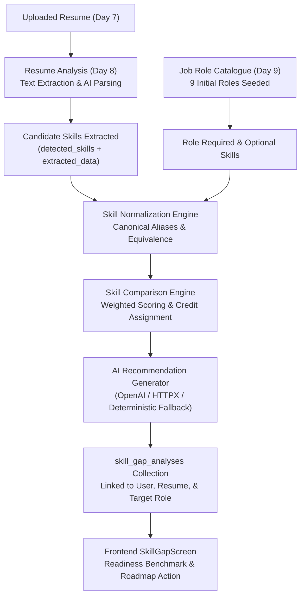

# SkillBridge AI — Day 9: Skill Gap Analysis and Job Role Matching Documentation

## 1. Overview & Architecture

Day 9 delivers an end-to-end, AI-powered skill gap analysis and target job role matching engine for SkillBridge AI. It connects candidate skills extracted during Day 8 resume analysis with market-calibrated job role benchmarks to calculate weighted competency scores, categorize skills (matched, partially matched, missing, and optional), and deliver actionable improvement roadmaps with concrete project ideas.

### High-Level Architecture Flow



---

## 2. Data Models & Database Design

### MongoDB Collections

#### `job_roles` Collection
Stores standardized industry benchmark roles, competency weights (1–5 scale), category, and experience level:
```json
{
  "_id": "ObjectId",
  "slug": "backend-developer",
  "title": "Backend Developer",
  "category": "Backend Engineering",
  "description": "Design and build robust, scalable server-side systems, RESTful microservices, and databases.",
  "experience_level": "Mid",
  "required_skills": [
    {"name": "Python", "importance": 5, "category": "Languages", "description": "Core language proficiency"},
    {"name": "FastAPI", "importance": 4, "category": "Frameworks", "description": "Async web APIs, Pydantic validation"},
    {"name": "REST APIs", "importance": 5, "category": "Architecture", "description": "HTTP status codes, RESTful API design"},
    {"name": "PostgreSQL", "importance": 4, "category": "Databases", "description": "Relational schema design, queries, transactions"},
    {"name": "MongoDB", "importance": 3, "category": "Databases", "description": "Document storage, aggregation"},
    {"name": "Git", "importance": 4, "category": "Tools", "description": "Version control, collaborative code reviews"},
    {"name": "Docker", "importance": 4, "category": "DevOps", "description": "Containerization, multi-stage builds"}
  ],
  "optional_skills": [
    {"name": "Redis", "importance": 3, "category": "Databases", "description": "In-memory caching and session store"},
    {"name": "Kafka", "importance": 3, "category": "Messaging", "description": "Event-driven messaging and streaming"}
  ],
  "is_active": true,
  "created_at": "2026-11-14T05:00:00Z",
  "updated_at": "2026-11-14T05:00:00Z"
}
```
**Indexes:**
- `{ slug: 1 }` (unique)
- `{ category: 1 }`

#### `skill_gap_analyses` Collection
Stores candidate comparison snapshots with verified audit trails:
```json
{
  "_id": "ObjectId",
  "user_id": "ObjectId / string",
  "resume_id": "ObjectId / string",
  "resume_analysis_id": "ObjectId / string",
  "target_role_id": "ObjectId / string",
  "target_role_title": "Backend Developer",
  "match_percentage": 69,
  "summary": "You possess foundational qualifications for Backend Developer...",
  "counts": {
    "matched": 4,
    "partial": 1,
    "missing": 2,
    "optional": 2,
    "total_required": 7
  },
  "matched_skills": [
    {"name": "Python", "importance": 5, "category": "Languages", "evidence": "Verified resume evidence for Python"}
  ],
  "partially_matched_skills": [
    {"name": "PostgreSQL", "importance": 4, "category": "Databases", "reason": "Demonstrated background in SQL"}
  ],
  "missing_skills": [
    {"name": "Docker", "importance": 4, "category": "DevOps"}
  ],
  "optional_skills": [
    {"name": "Redis", "importance": 3, "category": "Databases", "status": "missing"}
  ],
  "recommendations": [
    {
      "skill": "Docker",
      "priority": "high",
      "reason": "Docker is a key requirement for Backend Developer positions.",
      "practical_project": "Build an end-to-end portfolio module featuring Docker with automated tests and CI deployment.",
      "learning_activity": "Complete hands-on documentation tutorials and build 2 micro-projects exercising core Docker paradigms."
    }
  ],
  "is_stale": false,
  "ai_metadata": {"provider": "openai", "model": "gpt-4o-mini", "prompt_version": "skill-gap-v1"},
  "created_at": "2026-11-14T05:30:00Z",
  "updated_at": "2026-11-14T05:30:00Z"
}
```
**Indexes:**
- `{ user_id: 1, created_at: -1 }`

---

## 3. Skill Normalization & Comparison Engine

### Canonical Alias Table
The normalization service (`SkillNormalizationService`) cleanses and canonicalizes tech keywords:
- **Languages & Frameworks:** `js` / `javascript` / `es6` $\to$ `JavaScript`, `ts` $\to$ `TypeScript`, `reactjs` / `react.js` $\to$ `React`, `node` / `nodejs` $\to$ `Node.js`, `postgres` / `psql` $\to$ `PostgreSQL`, `k8s` $\to$ `Kubernetes`, `py` $\to$ `Python`.
- **False-Positive Guardrails:** Java is never merged with JavaScript; React is never merged with Angular; SQL is never merged with MongoDB; C++ is never merged with C#.

### Weighted Scoring Formula
To provide transparent and explainable scores, competencies are assigned importance weights ($w_i \in [1, 5]$):
- **Matched Skill:** Factor $f_i = 1.0$ (100% credit)
- **Partially Matched Skill:** Factor $f_i = 0.5$ (50% credit for transferable knowledge, e.g. SQL $\to$ PostgreSQL)
- **Missing Skill:** Factor $f_i = 0.0$ (0% credit)
- **Optional Skills:** Tracked separately for candidate differentiation; they **never penalize** the required denominator.

$$\text{Earned Score} = \sum_{i \in \text{Required}} (f_i \times w_i)$$

$$\text{Total Required} = \sum_{i \in \text{Required}} w_i$$

$$\text{Match Percentage} = \min\left(100, \max\left(0, \operatorname{round}\left( \frac{\text{Earned Score}}{\text{Total Required}} \times 100 \right)\right)\right)$$

---

## 4. REST API Specification

### Endpoints Summary

| Method | Endpoint | Description | Auth Required |
|---|---|---|---|
| `GET` | `/api/v1/job-roles` | List available roles with search (`q`) and category filter | No |
| `GET` | `/api/v1/job-roles/{role_id}` | Retrieve role details by ObjectId or slug | No |
| `POST` | `/api/v1/skill-gap/analyze` | Trigger or recalibrate skill gap analysis | Yes (JWT) |
| `POST` | `/api/v1/skill-gap-analyses` | Alias route matching Day 2 specification | Yes (JWT) |
| `GET` | `/api/v1/skill-gap/latest` | Retrieve latest analysis for current user (with stale detection) | Yes (JWT) |
| `GET` | `/api/v1/skill-gap/{analysis_id}` | Retrieve specific analysis by ID (scoped to current user) | Yes (JWT) |
| `GET` | `/api/v1/skill-gap-analyses` | List user's analysis history | Yes (JWT) |

---

## 5. Idempotent Database Seeding

The application automatically seeds 9 industry benchmark roles during database initialization (`app/db/seeds/job_roles.py` called in `init_db()`):
1. **Frontend Developer** (Mid, Frontend Engineering)
2. **Backend Developer** (Mid, Backend Engineering)
3. **Full Stack Developer** (Mid, Software Engineering)
4. **React Developer** (Mid, Frontend Engineering)
5. **Python Developer** (Mid, Software Engineering)
6. **Node.js Developer** (Mid, Backend Engineering)
7. **Java Developer** (Mid, Enterprise Engineering)
8. **Data Analyst** (Mid, Data & Analytics)
9. **DevOps Engineer** (Mid, Infrastructure & Operations)

Each role is upserted on `slug`, ensuring zero duplicates on restarts or schema upgrades.

---

## 6. Frontend Dashboard Integration (`SkillGapScreen.tsx`)

The frontend delivers a rich user experience with:
- **Role Selector Toolbar:** Allows quick switching between roles with category badges and source resume reference.
- **Role Readiness Benchmark Banner:** Dynamic match score progress bar, benchmark score, and executive summary.
- **Summary Stat Cards:** Color-coded count badges for Verified Matched, Partially Matched, Missing Competencies, and Optional Bonus skills.
- **Filter Tabs:** Quickly isolates skills by status (All, Missing, Partial, Matched, Optional).
- **Detailed Skill Cards:** Clear indication of earned credit, importance rating, and evidence snippets.
- **AI-Powered Actionable Recommendations:** Prioritized improvement items with concrete practical project ideas and targeted learning activities.
- **Edge State Handling:** Gracefully handles missing resume, unanalyzed resume, stale analysis warnings with one-click recalibration, and loading states.

