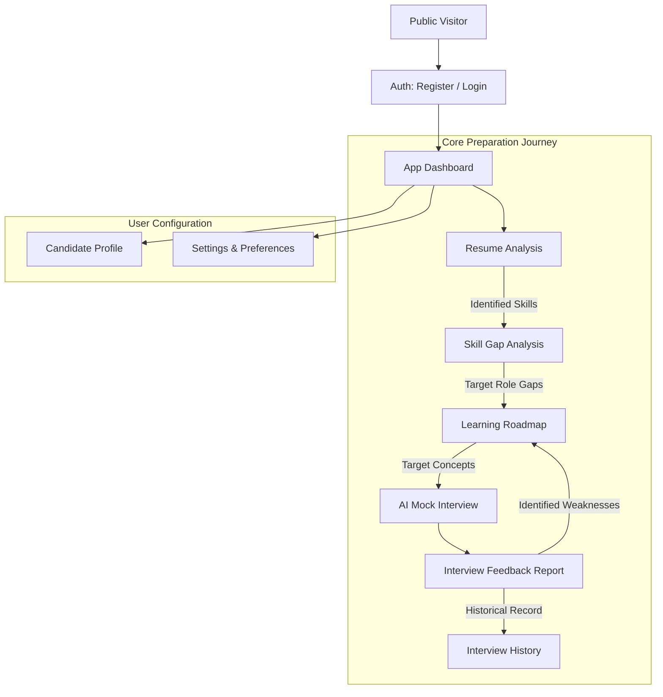

# SkillBridge AI — UI/UX Design and Interface Planning

**Phase 1 · Week 1 · Day 3 Deliverable**  
**Role:** Senior UI/UX Designer, Product Designer & Frontend Architect  
**Status:** Approved Specification Baseline  
**Related Documents:** [docs/design-system.md](file:///Users/macos/Documents/Skillbridge/docs/design-system.md) · [docs/screen-specifications.md](file:///Users/macos/Documents/Skillbridge/docs/screen-specifications.md) · [docs/user-flows.md](file:///Users/macos/Documents/Skillbridge/docs/user-flows.md) · [docs/component-inventory.md](file:///Users/macos/Documents/Skillbridge/docs/component-inventory.md)

---

## 1. Executive Summary & Design Philosophy

SkillBridge AI is an AI-powered career preparation platform designed to help students, job seekers, and software engineers prepare for technical interviews, analyze resumes, identify skill gaps, and execute personalized learning roadmaps.

Preparing for technical roles is inherently stressful, fragmented, and opaque. Most candidates juggle multiple disparate tools: disconnected resume builders, LeetCode tabs, mock interview recordings, and ad-hoc Notion checklists.

The design philosophy of SkillBridge AI rests on four foundational pillars:

```text
┌────────────────────────────────────────────────────────────────────────┐
│                        SKILLBRIDGE DESIGN PILLARS                      │
├────────────────────┬────────────────────┬──────────────────────────────┤
│ 1. Calm Authority  │ 2. Transparent AI  │ 3. Actionable Momentum       │
│ Professional,      │ Clear attribution, │ Every diagnosis is linked    │
│ high-contrast,     │ explicit estimates,│ to an immediate step forward;│
│ clutter-free SaaS  │ human-editable     │ no dead ends.                │
└────────────────────┴────────────────────┴──────────────────────────────┘
```

1. **Calm Authority & Trust:** Technical career readiness demands an atmosphere of precision and trustworthiness. We avoid garish neon gradients, excessive floating particles, and noisy visual gimmicks. The interface reflects the aesthetic standard of modern engineering platforms (Linear, Vercel, Stripe) with crisp typography, restrained neutral backgrounds, subtle borders, and intentional accent color.
2. **Transparent, Calibrated AI:** AI outputs are framed as advisory assessments, not definitive hiring guarantees. Extracted resume attributes, skill-gap diagnoses, and interview evaluations are always made transparent with clear source attribution and user-override capabilities.
3. **Actionable Momentum:** Every screen connects diagnosis to action. A resume score links directly to missing skills; a missing skill links directly to a roadmap task; a completed roadmap milestone unlocks targeted mock interview questions.
4. **Distraction-Free Focus:** High-stakes workflows—specifically the AI mock interview session—strip away extraneous sidebar items, notifications, and clutter, offering a dedicated zen workspace where candidates can think clearly.

---

## 2. Product Design Direction & Aesthetics

### 2.1 Theme & Visual Identity
- **Primary Theme:** Light mode as the primary foundation for clean readability and broad accessibility. Full dark-mode readiness using HSL CSS variables.
- **Backgrounds:** Clean neutral canvas (`#F8FAFC` / Slate 50 in light mode; `#0B0F19` in dark mode) paired with elevated pure white or dark-zinc cards (`#FFFFFF` / `#111827`).
- **Signature Accent:** Precision Indigo/Violet (`#4F46E5` / `#6366F1`). It conveys intelligence and analytical rigor without feeling cold or sterile.
- **Semantic Colors:**
  - **Success / Matched Skills:** Emerald (`#10B981` / `#059669`)
  - **Warning / Skill Gaps / Attention:** Amber (`#F59E0B` / `#D97706`)
  - **Error / High-Priority Missing:** Rose (`#F43F5E` / `#E11D48`)
  - **Info / In Progress:** Sky (`#0EA5E9` / `#0284C7`)
- **Visual Weight & Elevation:** Cards feature subtle 1px border outlines (`border-slate-200` in light, `border-slate-800` in dark) with soft, diffused shadows (`shadow-sm` and `shadow-md`). Deep 3D drop-shadows and heavy borders are strictly avoided.

### 2.2 Typography Direction
- **Primary Font Family:** `Inter` via Google Fonts. High legibility at small sizes (12px–14px), balanced x-height, and neutral sans-serif structure.
- **Monospace Accent:** `JetBrains Mono` or `ui-monospace` for code snippets, skill tags, scores, and timestamp metrics.
- **Hierarchy:** Strict proportional scaling with high contrast between headers (semibold/bold) and body copy (regular/medium) to facilitate rapid scanning.

### 2.3 What to Avoid
- ❌ Chaotic multi-color rainbow gradients.
- ❌ Uncontrollable auto-advancing carousels or intrusive popups.
- ❌ Cluttered dashboards packed with redundant metric widgets.
- ❌ Generic chatbot avatars with pulsing neon speech bubbles.
- ❌ Fake data presented without clear demo/sample labels.
- ❌ Low-contrast text (e.g., light gray on white).

---

## 3. Application Layout Architecture

The authenticated application uses an ergonomic, responsive layout architecture designed to handle deep analytical tables as well as focused task views.

```text
+-------------------------------------------------------------------------------+
| TOP BAR: [Breadcrumb / Page Title]          [Search Cmd+K] [Help] [User Profile]|
+-------------------+-----------------------------------------------------------+
| APP SIDEBAR (260px)| MAIN CONTENT WORKSPACE (Fluid max-w-7xl)                  |
|                   |                                                           |
| ⚡ SkillBridge AI | ┌───────────────────────────────────────────────────────┐ │
|                   | │ Page Header & Context Actions                         │ │
| - Dashboard       | └───────────────────────────────────────────────────────┘ │
| - Resume Analysis |                                                           |
| - Skill Gaps      | ┌───────────────────────────┐ ┌─────────────────────────┐ │
| - Learning Roadmap| │ Primary Analysis / Form   │ │ Context / Side Panel    │ │
| - AI Interview    | │ (65% width on desktop)    │ │ (35% width on desktop)  │ │
| - History         | │                           │ │                         │ │
|                   | └───────────────────────────┘ └─────────────────────────┘ │
| ───────────────   |                                                           |
| - Profile         |                                                           |
| - Settings        |                                                           |
+-------------------+-----------------------------------------------------------+
```

### 3.1 Desktop Layout (>= 1024px)
- **Left Sidebar Navigation:**
  - Width: Fixed at 260px (`w-64`), non-collapsible or collapsible to 72px icon-only rail on laptop viewports (1024px–1280px).
  - Background: Crisp off-white (`bg-white` / `dark:bg-slate-900`) with a persistent right border (`border-r border-slate-200`).
  - Contains: Brand logo, main navigation group, secondary utility group (Profile, Settings), and current target role badge.
- **Top Navigation Bar:**
  - Height: Fixed 64px (`h-16`), sticky at top (`sticky top-0 z-30`).
  - Contains: Dynamic breadcrumb trail, global quick-search trigger (`Cmd+K`), notification/status bell indicator (MVP placeholder), and user profile dropdown with role badge.
- **Main Content Area:**
  - Fluid container with maximum bound: `max-w-7xl mx-auto px-6 py-8`.
  - Structured into logical vertical sections: Page Header → Action Banners → Primary Work Area → Secondary Supporting Context.

### 3.2 Tablet Layout (768px - 1023px)
- Sidebar collapses into an accessible slide-over sheet triggered by a top-left hamburger icon or remains as a compact 72px icon-only rail.
- Two-column dashboard grids collapse gracefully to a 1-column stack or balanced 50/50 split.
- Tables support horizontal scrolling with sticky first columns.

### 3.3 Mobile Layout (< 768px)
- Top bar contains brand logo, hamburger menu button, and user avatar.
- Navigation opens as a full-height slide-over sheet with high-contrast touch targets (minimum 44x44px).
- Bottom safe area padding for sticky mobile CTAs (e.g., "Submit Answer", "Generate Roadmap").
- Card padding reduces from `p-6` to `p-4` to preserve screen real estate.

### 3.4 Focused / Zen Layout (AI Interview Session)
When participating in an active AI mock interview:
- The standard sidebar and top navigation are completely hidden to minimize cognitive distraction.
- Replaced by an **Interview Header Bar**:
  - Left: Interview title + Target role badge ("Senior Backend Engineer — Technical")
  - Center: Question progress tracker ("Question 3 of 6 • Follow-up 1 of 2") + countdown timer (optional/pauseable)
  - Right: "Pause" and "Exit Interview" actions with confirmation modals.

---

## 4. Navigation Architecture & Information Hierarchy

Navigation is organized around the candidate's natural progression from diagnostic evaluation to proactive learning and real-world rehearsal.



### 4.1 Primary Navigation Items

| Order | Navigation Item | Route | Icon (Lucide) | Purpose |
|---|---|---|---|---|
| 1 | **Dashboard** | `/dashboard` | `LayoutDashboard` | High-level readiness overview, active roadmap progress, quick actions, recent interview scores. |
| 2 | **Resume Analysis** | `/resume` | `FileText` | Upload PDF/DOCX resume, review extracted skills, evaluate strengths/gaps, receive formatting suggestions. |
| 3 | **Skill Gap Analysis** | `/skill-gap` | `Compass` | Compare current verified skills against specific target roles or pasted job descriptions. |
| 4 | **Learning Roadmap** | `/roadmap` | `Milestone` | Week-by-week actionable study schedule with prioritized milestones, resources, and task checklists. |
| 5 | **AI Interview** | `/interview` | `Bot` | Configure and start a realistic, adaptive mock interview session (technical or behavioral). |
| 6 | **Interview History** | `/interview/history` | `History` | Chronological list of completed mock sessions with detailed scores, transcripts, and progress trends. |
| 7 | **Profile** | `/profile` | `User` | Career goals, target job role, verified skills, years of experience, and education details. |
| 8 | **Settings** | `/settings` | `Settings` | Account security, notification preferences, password updates, and theme selector. |

---

## 5. Core UX Principles & Heuristics

### 5.1 Cognitive Load Reduction
- **Single-Focus Task States:** During complex tasks (e.g., uploading a resume or answering an interview question), secondary widgets are muted or deferred.
- **Progressive Disclosure:** Deep feedback (e.g., granular breakdown of communication clarity or algorithmic complexity) is accessible via accordions or tabs, keeping the primary overview scannable.

### 5.2 Deterministic & Transparent AI Feedback
- Every AI-generated assessment includes clear explanatory rationale:
  - *Example:* "Flagged as missing: Docker & Container Orchestration — Not detected in resume experience descriptions."
- A persistent advisory disclaimer is rendered on all AI feedback pages:
  - *"SkillBridge AI scores are estimated benchmarks based on industry standards and your provided answers. They are advisory tools and do not guarantee hiring outcomes."*

### 5.3 Resilient Asynchronous Feedback
- Long-running operations (resume parsing, AI feedback generation) must never leave the user wondering if the system is frozen.
- We utilize three-stage feedback:
  1. Instant optimistic confirmation (e.g., "File uploaded successfully").
  2. Multi-step progress indicator with descriptive status copy (e.g., "Extracting text → Identifying technical competencies → Comparing with industry standards").
  3. Clear failure recovery with retry and diagnostic support without losing user inputs.

### 5.4 Reversibility and Editability
- Users can manually edit AI-extracted resume details (e.g., correcting an improperly parsed skill or job title) before generating down-funnel roadmaps.
- Destructive actions (e.g., deleting a resume, abandoning an active interview) require explicit confirmation dialogs.

---

## 6. Interaction Patterns

| Pattern | UI Treatment | Use Case |
|---|---|---|
| **Primary Action** | High-contrast filled indigo button (`bg-primary text-white shadow-sm hover:bg-primary/90`) | "Start Interview", "Generate Roadmap", "Upload Resume" |
| **Secondary Action** | Subtle neutral outline button (`border border-slate-300 hover:bg-slate-50`) | "Save Draft", "View Details", "Filter" |
| **Destructive Action** | Muted rose outline or fill (`text-destructive hover:bg-destructive/10`) | "Delete Resume", "Cancel Session" |
| **Inline Status Tag** | Pill badge with dot indicator (`rounded-full px-2.5 py-0.5 text-xs font-medium`) | "In Progress", "Completed", "Needs Attention" |
| **Transient Feedback** | Toast notification (bottom-right on desktop, top-center on mobile) | "Task marked as complete", "Draft saved" |
| **Blocking Feedback** | Centered modal with backdrop blur (`backdrop-blur-sm bg-black/40`) | Confirmation of interview exit, target role switch |
