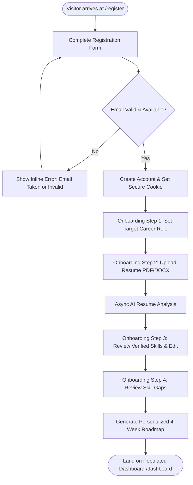
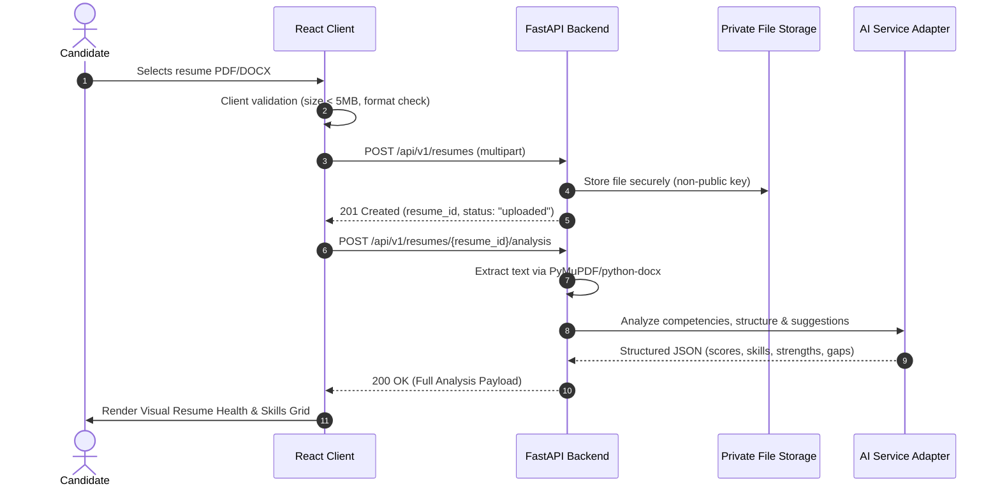
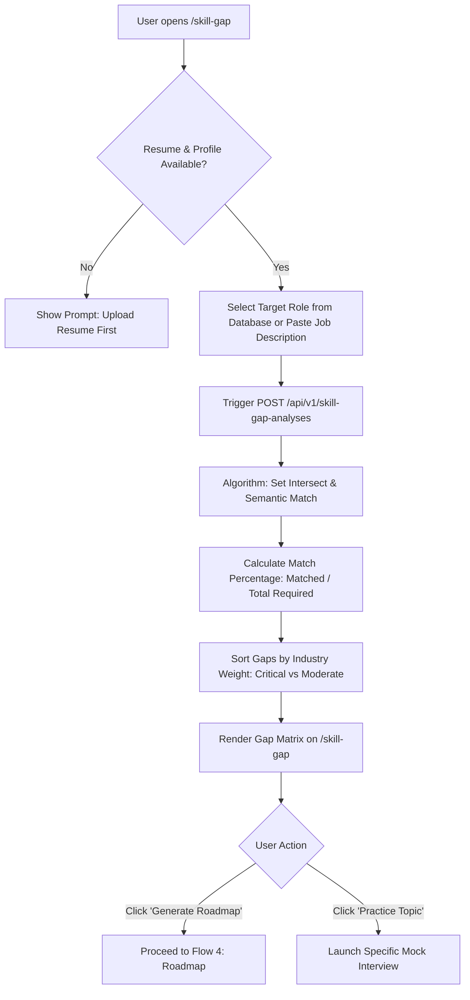
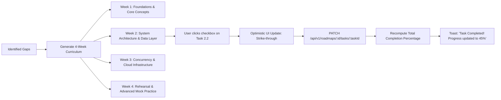
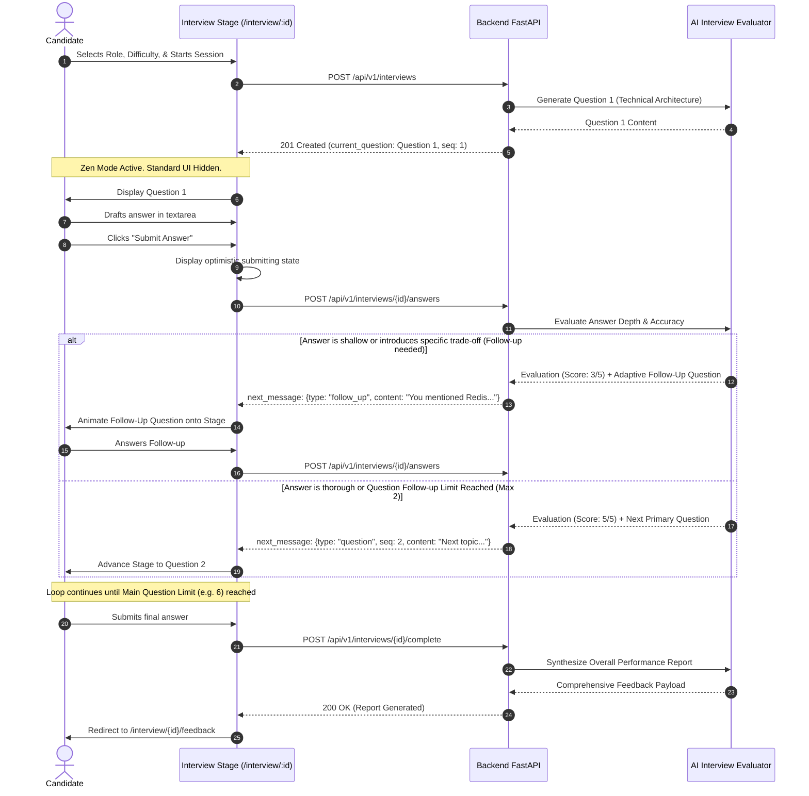

# SkillBridge AI — User Experience Flows & State Diagrams

**Phase 1 · Week 1 · Day 3 Deliverable**  
**Role:** Senior UI/UX Designer & Product Architect  
**Scope:** End-to-end user journeys, decision logic, async processing lifecycles, and Mermaid interaction diagrams.  
**Related Documents:** [docs/screen-specifications.md](file:///Users/macos/Documents/Skillbridge/docs/screen-specifications.md) · [docs/api-design.md](file:///Users/macos/Documents/Skillbridge/docs/api-design.md) · [docs/architecture.md](file:///Users/macos/Documents/Skillbridge/docs/architecture.md)

---

## 1. Flow Directory & Summary

```text
┌────────────────────────────────────────────────────────────────────────┐
│                        CORE APPLICATION FLOWS                          │
├────────────────────────────────────────────────────────────────────────┤
│ Flow 1: New User Onboarding & First-Value Path                         │
│ Flow 2: Resume Upload, Parsing & AI Competency Audit                   │
│ Flow 3: Target Role Selection & Skill Gap Analysis                    │
│ Flow 4: Learning Roadmap Generation & Task Progression                 │
│ Flow 5: Adaptive AI Mock Interview & Evaluation Engine                │
│ Flow 6: Closed-Loop Learning & Feedback Synchronization               │
└────────────────────────────────────────────────────────────────────────┘
```

---

## 2. Flow 1: New User Onboarding & First-Value Path

This flow guides a first-time candidate from registration directly to their first actionable roadmap, establishing trust and delivering immediate product value within 5 minutes.

### 2.1 Mermaid Process Diagram



### 2.2 Step-by-Step Step Sequence

| Step | User Action | System Trigger & Response | Success Criteria & Outcome | Error & Edge Cases |
|---|---|---|---|---|
| **1.1 Register** | Enters name, email, password; accepts terms; clicks "Create Account". | `POST /api/v1/auth/register` → Hashes password with Argon2id, generates JWT tokens in HttpOnly cookie. | Account created, redirected to Onboarding Step 1. | Duplicate email shows clear `409 Conflict` message; weak password flagged. |
| **1.2 Target Role** | Selects target job role from searchable select list (e.g., "Senior Backend Engineer"). | `PUT /api/v1/profiles/me` with `target_role_id`. | Profile updated with target career objective. | If role not listed, user can enter custom title. |
| **1.3 Upload Resume** | Drags & drops PDF resume (up to 5MB). | `POST /api/v1/resumes` (multipart/form-data) → Validates file magic bytes and size. | File uploaded, returns `202 Accepted` with `resume_id`. | File > 5MB or invalid MIME rejected immediately with helpful toast. |
| **1.4 AI Audit** | Waits as progress bar indicates parsing and competency extraction. | `POST /api/v1/resumes/:id/analysis` → Background parsing with PyMuPDF and LLM extraction. | Returns structured strengths, gaps, and detected skills list. | If parsing fails, user gets retry button or manual entry fallback. |
| **1.5 Skill Review** | Reviews detected skills; tags any missing competencies manually. | `PUT /api/v1/profiles/me` updates verified skills inventory. | Verified skills baseline established. | User can delete incorrectly extracted skills. |
| **1.6 Gap Analysis** | Clicks "Calculate Skill Gaps". | `POST /api/v1/skill-gap-analyses` → Compares verified skills with target role requirements. | Categorizes gaps into Critical, Moderate, and Matched. | Target role missing requirements triggers fallback baseline role. |
| **1.7 Roadmap** | Clicks "Generate My Roadmap". | `POST /api/v1/roadmaps` → Synthesizes gaps into weekly milestones and tasks. | Generated roadmap saved, user redirected to Dashboard with toast. | AI generation timeout triggers retry modal. |

---

## 3. Flow 2: Resume Upload, Parsing & AI Competency Audit

This flow details the asynchronous pipeline that safely extracts text from uploaded files, passes content to the backend AI service, and returns structured feedback.

### 3.1 Mermaid Sequence Diagram



### 3.2 State Transition Matrix for Resume Entity

```text
┌──────────────┐     Upload      ┌──────────────┐    Process      ┌──────────────┐
│  (None /     │ ──────────────> │   Uploaded   │ ──────────────> │  Processing  │
│  Unattached) │                 │              │                 │              │
└──────────────┘                 └──────────────┘                 └──────────────┘
                                                                         │
                                       ┌─────────────────────────────────┴───────────────────┐
                                       ▼                                                     ▼
                                ┌──────────────┐                                      ┌──────────────┐
                                │  Completed   │                                      │    Failed    │
                                │ (Structured) │                                      │ (Retryable)  │
                                └──────────────┘                                      └──────────────┘
```

---

## 4. Flow 3: Target Role Selection & Skill Gap Analysis

Connecting candidate capabilities with real-world hiring expectations.

### 4.1 Mermaid Logic Flow



### 4.2 Gap Classification Heuristics
- **Critical Gap:** Skill appears in > 80% of target role job postings (e.g., *Distributed System Architecture*, *SQL Indexing*). Highlighted in Rose.
- **Moderate Gap:** Skill appears in 40%–80% of job postings (e.g., *Redis Caching*, *Docker Compose*). Highlighted in Amber.
- **Matched Skill:** User possesses verifiable experience or passed relevant mock interview questions. Highlighted in Emerald.

---

## 5. Flow 4: Learning Roadmap Generation & Task Progression

The bridge between diagnosis and mastery: breaking abstract goals into weekly, achievable tasks.

### 5.1 Mermaid Flow Diagram



---

## 6. Flow 5: Adaptive AI Mock Interview & Evaluation Engine

The platform's core differentiator: a multi-turn, adaptive technical interview where follow-up questions dynamically probe the candidate's actual answers.

### 6.1 Mermaid Detailed Sequence Flow



### 6.2 Adaptive Follow-Up Decision Rules

```text
                       User Submits Answer
                                │
                                ▼
                   AI Evaluates Technical Depth
                                │
         ┌──────────────────────┴──────────────────────┐
         ▼                                             ▼
Does answer warrant probe?                    Is answer complete?
- Missing edge case                           - Explains trade-offs
- Ambiguous technology choice                 - Covers edge cases
- Concurrency trade-off                       - High technical accuracy
         │                                             │
         ▼                                             ▼
Has Question reached follow-up limit?          Advance to NEXT
- If < 2 follow-ups: Generate FOLLOW-UP        PRIMARY QUESTION
- If = 2 follow-ups: Advance to NEXT QUESTION
```

---

## 7. Flow 6: Closed-Loop Learning & Feedback Synchronization

SkillBridge AI prevents preparation from becoming static by channeling interview results directly back into the candidate's learning plan.

```mermaid
flowchart TD
    A[Complete Mock Interview] --> B[Generate Feedback Report]
    B --> C{Identify Weak Dimensions}
    C -->|e.g. Scored 4/10 on Distributed Transactions| D[Flag Topic in Skill-Gap Matrix]
    D --> E[Update Recommended Learning Tasks in Active Roadmap]
    E --> F[Dashboard Highlights: 'Practice 2 Tasks to boost score']
    F --> G[Candidate Completes Tasks]
    G --> H[Candidate Re-takes Interview on same topic]
    H --> I[Score Trajectory Reflects Growth (+18%)]
```

---

## 8. Error Handling & Recovery Across Flows

| Failure Mode | User Experience Impact | Automatic System Recovery | Manual User Escape Hatch |
|---|---|---|---|
| **Network disconnect during interview** | Answer submission fails with toast. | Answer is preserved in browser `localStorage`. System detects network return and re-enables submit. | User can copy answer text to clipboard; "Retry Connection" button. |
| **AI provider rate limit / timeout** | Processing spinner exceeds 15 seconds. | Backend automatically retries with secondary provider or exponential backoff. | UI offers: *"AI response is taking longer than usual. [Wait] or [Retry]"*. |
| **Accidental tab closure in interview** | Active interview state left open. | Session remains `in_progress` on server. | Re-navigating to `/interview/:id` restores exact question sequence and drafts. |
| **Unsupported resume formatting** | Server fails to parse text from image-only PDF. | Server returns `422 Unprocessable` with code `OCR_REQUIRED`. | Error alert explains: *"This PDF contains scanned images without text. Please upload a standard text PDF or DOCX."* |
