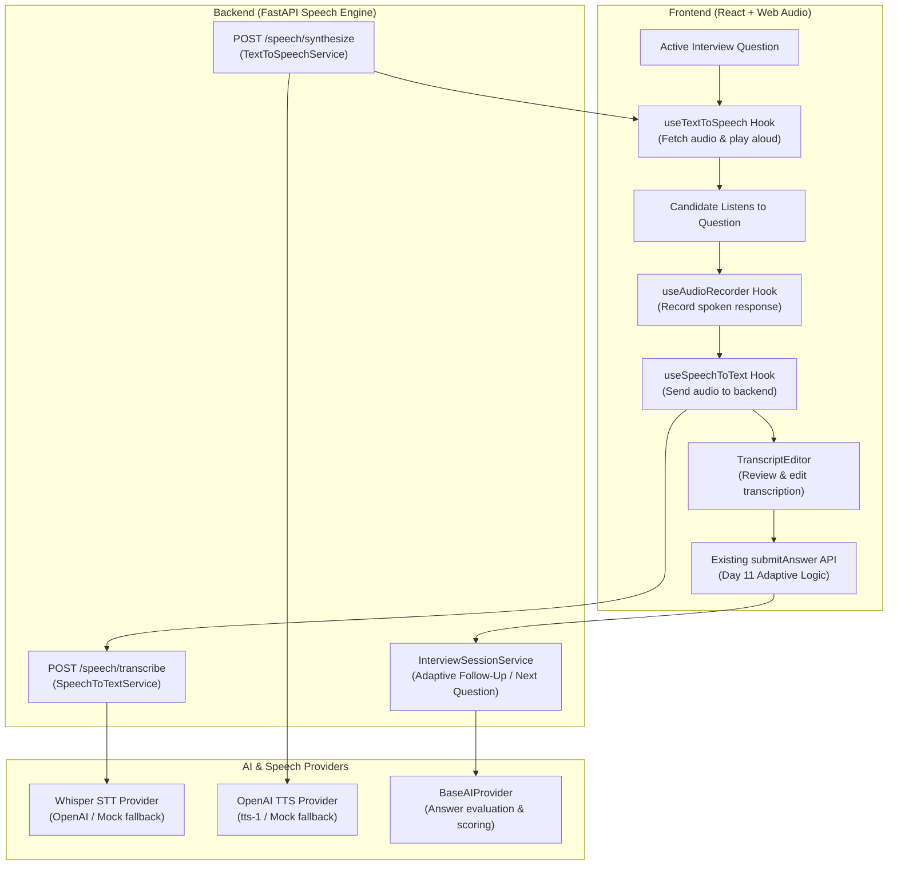

# SkillBridge AI — Day 12: Voice-Based AI Mock Interview System

## 1. Feature Overview

Day 12 extends SkillBridge AI with a **Voice-Based AI Mock Interview System**. Candidates can participate in verbal interview simulations where interviewer questions are spoken aloud using Text-to-Speech (TTS), and candidate answers are recorded directly in the browser and transcribed via Speech-to-Text (STT) for review and adaptive evaluation.

The voice interface integrates into the Day 11 interview lifecycle without duplicating evaluation logic or database collections. Candidates can switch between **Voice Mode** and **Text Mode** at any point without losing interview progress, draft answers, or feedback reports.



---

## 2. Voice Architecture & Provider Abstraction

The voice engine is built upon two provider abstractions, separating speech generation and transcription from application logic:

### Speech-to-Text (STT) Abstraction:
- **Base Interface:** [`BaseSTTProvider`](file:///Users/macos/Documents/Skillbridge/backend/app/integrations/speech_to_text/base.py) defines `transcribe(audio_bytes, filename, content_type) -> Dict[str, Any]`.
- **Production Provider:** [`OpenAIWhisperSTTProvider`](file:///Users/macos/Documents/Skillbridge/backend/app/integrations/speech_to_text/providers/openai_whisper.py) streams audio to OpenAI Whisper (`/v1/audio/transcriptions`).
- **Development/Test Provider:** [`MockSTTProvider`](file:///Users/macos/Documents/Skillbridge/backend/app/integrations/speech_to_text/providers/mock_stt.py) delivers deterministic transcriptions with duration and confidence metrics without network calls.
- **Factory:** [`get_stt_provider()`](file:///Users/macos/Documents/Skillbridge/backend/app/integrations/speech_to_text/provider_factory.py) automatically selects the provider based on configuration.

### Text-to-Speech (TTS) Abstraction:
- **Base Interface:** [`BaseTTSProvider`](file:///Users/macos/Documents/Skillbridge/backend/app/integrations/text_to_speech/base.py) defines `synthesize(text, voice, speed) -> bytes`.
- **Production Provider:** [`OpenAITTSProvider`](file:///Users/macos/Documents/Skillbridge/backend/app/integrations/text_to_speech/providers/openai_tts.py) calls OpenAI Audio Speech (`/v1/audio/speech`) returning MP3 audio streams.
- **Development/Test Provider:** [`MockTTSProvider`](file:///Users/macos/Documents/Skillbridge/backend/app/integrations/text_to_speech/providers/mock_tts.py) generates valid minimal PCM WAV audio frames locally.
- **Factory:** [`get_tts_provider()`](file:///Users/macos/Documents/Skillbridge/backend/app/integrations/text_to_speech/provider_factory.py).

---

## 3. Configuration & Environment Variables

| Variable | Default | Description |
| :--- | :--- | :--- |
| `AI_API_KEY` | `None` | OpenAI API key used for STT, TTS, and interview evaluation |
| `STT_PROVIDER` | `"openai"` | STT provider (`"openai"` or `"mock"`) |
| `STT_MODEL` | `"whisper-1"` | OpenAI transcription model |
| `STT_TIMEOUT_SECONDS` | `30` | Timeout in seconds for transcription requests |
| `MAX_AUDIO_SIZE_MB` | `25` | Maximum allowed audio upload payload size |
| `TTS_PROVIDER` | `"openai"` | TTS provider (`"openai"` or `"mock"`) |
| `TTS_MODEL` | `"tts-1"` | OpenAI speech synthesis model |
| `TTS_VOICE` | `"alloy"` | Default synthetic voice (`alloy`, `echo`, `fable`, `onyx`, `nova`, `shimmer`) |
| `TTS_TIMEOUT_SECONDS` | `30` | Timeout in seconds for synthesis requests |
| `TTS_MAX_CHARACTERS` | `2000` | Maximum character limit per synthesis call |

> [!NOTE]
> When `AI_API_KEY` is omitted, the factory gracefully activates `MockSTTProvider` and `MockTTSProvider`, enabling complete offline development, testing, and CI/CD without external dependencies.

---

## 4. API Endpoints

Registered under `/api/v1/speech` in [`backend/app/api/v1/endpoints/speech.py`](file:///Users/macos/Documents/Skillbridge/backend/app/api/v1/endpoints/speech.py):

### 1. `POST /api/v1/speech/transcribe`
- **Authentication:** Required (`Authorization: Bearer <token>`).
- **Content-Type:** `multipart/form-data`.
- **Form Param:** `file` (Binary audio stream).
- **Validation:**
  - File size $\le$ 25 MB (`413 Request Entity Too Large`).
  - Empty or $< 100$ bytes rejected (`400 EMPTY_AUDIO`).
  - MIME type and magic byte verification for WebM, WAV, MP3, M4A, OGG (`400 UNSUPPORTED_AUDIO_FORMAT`).
- **Temporary Storage Safety:** Temporary file staged using `tempfile.NamedTemporaryFile` and unlinked in a `finally:` block.
- **Response (`200 OK`):**
  ```json
  {
    "text": "In our architecture, we use FastAPI with dependency injection and Redis for token buckets.",
    "duration_seconds": 8.5,
    "language": "en",
    "confidence": 0.95
  }
  ```

### 2. `POST /api/v1/speech/synthesize`
- **Authentication:** Required (`Authorization: Bearer <token>`).
- **Content-Type:** `application/json`.
- **Body:**
  ```json
  {
    "text": "How do you handle race conditions during rate limiting in distributed environments?",
    "voice": "alloy",
    "speed": 1.0
  }
  ```
- **Validation:** Text length 1 to 2000 characters (`400 EMPTY_TTS_INPUT` / `400 TTS_INPUT_TOO_LONG`).
- **Response (`200 OK`):**
  - Content-Type: `audio/mpeg` (or `audio/wav`).
  - Raw binary audio stream for playback.

---

## 5. Frontend Voice Architecture

### Reusable Components:
1. [`VoiceRecorder.tsx`](file:///Users/macos/Documents/Skillbridge/frontend/src/features/interview/components/voice/VoiceRecorder.tsx):
   - Record button with animated pulse ring, live timer, and stop/discard controls.
2. [`AudioPlayer.tsx`](file:///Users/macos/Documents/Skillbridge/frontend/src/features/interview/components/voice/AudioPlayer.tsx):
   - Audio controller for interviewer question playback, mute toggle, and replay action.
3. [`AudioWaveform.tsx`](file:///Users/macos/Documents/Skillbridge/frontend/src/features/interview/components/voice/AudioWaveform.tsx):
   - Visual audio waveform bars reacting dynamically to speaking and listening activity.
4. [`MicrophonePermission.tsx`](file:///Users/macos/Documents/Skillbridge/frontend/src/features/interview/components/voice/MicrophonePermission.tsx):
   - Clear banner displayed when microphone access is prompt, denied, or unsupported, with instructions and a "Switch to Text Mode" fallback.
5. [`VoiceStatusIndicator.tsx`](file:///Users/macos/Documents/Skillbridge/frontend/src/features/interview/components/voice/VoiceStatusIndicator.tsx):
   - Live status pill showing states: `idle`, `speaking`, `listening`, `processing`, or `error`.
6. [`TranscriptEditor.tsx`](file:///Users/macos/Documents/Skillbridge/frontend/src/features/interview/components/voice/TranscriptEditor.tsx):
   - Editable transcript textarea with live word counter, "Re-record" button, and "Submit Spoken Answer" button.
7. [`VoiceInterviewPanel.tsx`](file:///Users/macos/Documents/Skillbridge/frontend/src/features/interview/components/voice/VoiceInterviewPanel.tsx):
   - Comprehensive container coordinating TTS, voice recording, STT transcription, and answer submission.

### Reusable Hooks:
1. [`useAudioRecorder.ts`](file:///Users/macos/Documents/Skillbridge/frontend/src/features/interview/hooks/useAudioRecorder.ts):
   - Manages `navigator.mediaDevices.getUserMedia()` and `MediaRecorder`.
   - Tracks audio levels via `AudioContext` and `AnalyserNode`.
   - Cleans up and stops all media tracks when recording completes or component unmounts.
2. [`useSpeechToText.ts`](file:///Users/macos/Documents/Skillbridge/frontend/src/features/interview/hooks/useSpeechToText.ts):
   - Posts recorded audio blobs to `/speech/transcribe`.
   - Tracks transcription state, error handling, and manual transcript edits.
3. [`useTextToSpeech.ts`](file:///Users/macos/Documents/Skillbridge/frontend/src/features/interview/hooks/useTextToSpeech.ts):
   - Requests speech synthesis from `/speech/synthesize` and plays audio via `Audio` and `URL.createObjectURL()`.
   - Manages playback lifecycle, mute toggle, replay, and object URL cleanup.

---

## 6. Voice and Text Mode Switching

Candidates can toggle between **Voice Mode** and **Text Mode** at any point in [`InterviewScreen.tsx`](file:///Users/macos/Documents/Skillbridge/frontend/src/features/interview/InterviewScreen.tsx):
- Mode switcher buttons (`Voice Mode` / `Text Mode`) are rendered above the interaction stage.
- Switching modes preserves draft answers, conversation history, question sequences, and elapsed timers.
- If microphone access is denied or the browser does not support audio recording, the user is offered a single-click fallback to Text Mode.
- Answer submissions in both modes route through the identical `submitAnswer` API (`POST /api/v1/interviews/{id}/answers`), guaranteeing uniform adaptive follow-up behavior.

---

## 7. Security, Reliability & Privacy

1. **Authentication Enforcement:** Both speech endpoints require authenticated JWT Bearer tokens.
2. **Audio Signature Verification:** Server validates magic bytes to prevent masquerading files (WebM, WAV, MP3, M4A, OGG).
3. **No Raw Audio Retention:** Recorded candidate audio is processed in memory or ephemeral temporary files and deleted immediately upon transcription completion or failure.
4. **Temporary File Leak Prevention:** Temp files are wrapped in `try ... finally` blocks with `os.unlink()`.
5. **Privacy Assurance:** Only audio recording and synthesis are implemented. Video, webcam capture, emotion analysis, and biometric tracking are strictly excluded.
6. **Provider Isolation:** Frontend code never handles or stores API keys or provider secrets.

---

## 8. Test Verification

### Backend Tests:
- **92 passed pytest tests** (11 new speech tests + 81 existing tests).
- Unit tests: `test_stt_service_unit`, `test_stt_service_rejects_empty`, `test_stt_service_rejects_unsupported`, `test_tts_service_unit`.
- Integration tests: `test_transcribe_endpoint_success`, `test_transcribe_unauthenticated`, `test_transcribe_empty_file_rejected`, `test_synthesize_endpoint_success`, `test_synthesize_empty_input_rejected`, `test_synthesize_too_long_rejected`, `test_synthesize_unauthenticated`.

### Frontend Tests:
- **62 passed vitest tests across 10 test suites** with zero failures.
- `VoiceInterview.test.tsx`:
  - `VoiceRecorder` renders idle state, timer, recording state, stop, and discard actions.
  - `AudioPlayer` handles question playback, replay, mute toggle, and synthesizing states.
  - `MicrophonePermission` handles denied access and triggers switch to text mode.
  - `VoiceStatusIndicator` verifies speaking, listening, and processing states.
  - `TranscriptEditor` verifies editing, word counts, re-recording, and submission.
  - `AudioWaveform` verifies rendering of animated audio bars.
- `InterviewScreens.test.tsx` and all previous test suites continue to pass with 0 regressions.
- `npm run build` passes with zero TypeScript errors.

